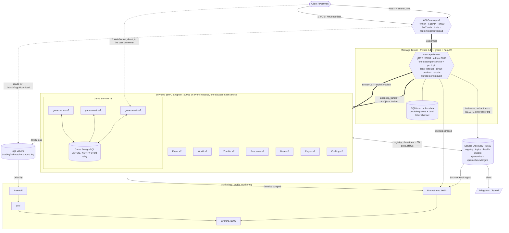
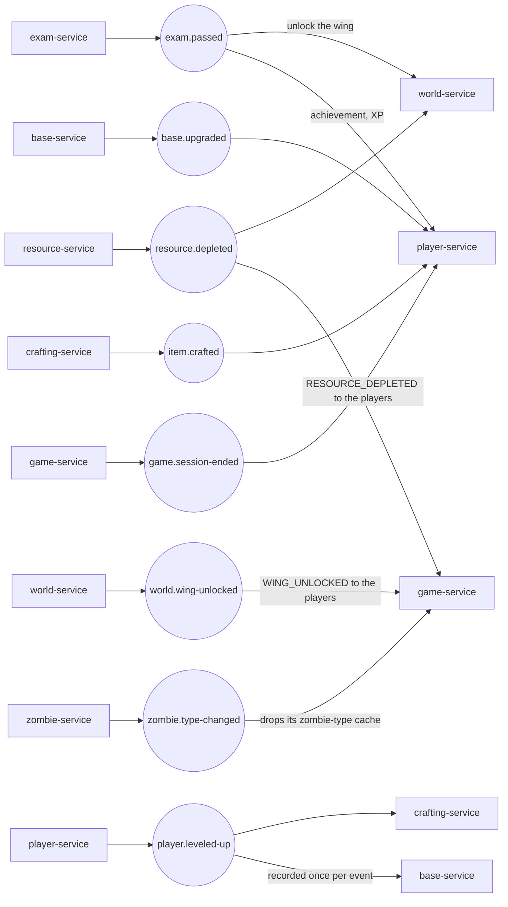

# In Kahoots with the Undead
 
**Course:** FAF.PAD21.1 — Autumn 2026
**Topic:** Topic 1 — Survive university exam season during a zombie apocalypse
**Team:** 6
 
| Name | Email | GitHub handle | Role focus |
|---|---|---|---|
| Mitu Vladlen | vladlen.mitu@gmail.com | _mituvladlen_ | Resource Service + Base Service |
| Moraru Gabriel | gabrielmoraru00@gmail.com | @Gabriel120405 | Crafting Service + Player Service |
| Mihai Mustea | mihaimustea121@gmail.com | @MihaiM1209 | World Service + Zombie Service |
| Alexandru Bujor | alexandru.bujor@isa.utm.md | @alexandru-bujor | Game Service + Exam Service |
 
---
 
## 1. Overview
 
Players wake up in FAF Cab and must survive the semester: gathering resources,
expanding their base, clearing zombies, and still passing exams administered
by Professor Zombies. The system is split into 8 microservices, each owning
a distinct slice of state and behavior.
 
## 2. Service Boundaries
 
| Service | Owns | Does NOT own |
|---|---|---|
| **Player Service** | Identity, auth, profiles, friends, presence, XP/levels, inventory (items), trading | Gameplay session state, map, resources |
| **Game Service** | Real-time sessions/lobbies, day/night cycle, timers, timed player actions, short-lived zombie behavior during a cycle | Persistent map, player inventory, resource quantities |
| **Exam Service** | Active exams, attempts, questions, answers, grades, pass/fail, course/achievement progression | Map unlocking itself (only notifies) |
| **World Service** | Campus map: rooms, corridors, zones, resource nodes, barricades, spawn configs | Base customizations, resource quantities |
| **Zombie Service** | Zombie type definitions, stats, behavior config, sprites, abilities | Runtime zombie instances during a session (that's Game Service) |
| **Resource Service** | Resource economy: quantities, location, idempotent gather/consume operations | Physical map, base state |
| **Base Service** | Player-built state: upgrades, barricades, facilities, storage, Kiki interactions | Campus geography (World Service owns that) |
| **Crafting Service** | Recipes, crafting validation, atomic craft operations | Player inventory storage (delegates the actual item transfer to Player Service) |
 
## 3. Architecture Diagram

**Lab 4.** Every request between components goes through the **Message Broker** over gRPC.
- **Requests.** The gateway checks the client (JWT, limits) and hands each request to the broker with `Broker.Call`, naming the service. The broker picks one instance of that service and calls its `Endpoint.Handle`. It balances by load, runs a circuit breaker per instance and reroutes a failed request to another instance. Services call each other the same way.
- **Events.** Services publish them to **topics** with `Broker.Publish`. The broker stores each event in SQLite before it answers, then delivers it once to every service that subscribed to the topic, to one of its instances (`Endpoint.Deliver`), with retries and a dead letter channel.
- **Direct traffic.** The only connection that does not go through the broker is the live WebSocket to Game, which the gateway negotiates and the client opens directly.

The rules are in [`docs/lab4-contract.md`](./docs/lab4-contract.md). Lab 3's rules (Service Discovery, `/status`, logs) still apply: [`docs/lab3-contract.md`](./docs/lab3-contract.md).



**Legend**
- **Thick arrows `==>`** go through the broker; the label says which gRPC call. Each one is either a request or an event.
- **A request** (`Broker.Call`).
  - The client's REST request reaches the gateway on **8080**, and the gateway turns it into a `Broker.Call` to the `<prefix>-service` queue (`/world/rooms` → `world-service`, path `/rooms`).
  - The broker calls `Endpoint.Handle` on **one** instance. That instance replays the request on its own HTTP routes, and the reply goes back the same way.
  - Services call each other only like this; `http://gateway:8081` is gone.
- **An event** (`Broker.Publish`). A service publishes it to a topic (`Broker.Publish`). The broker writes it to SQLite before it acknowledges, then sends it **once to every subscriber service**, to one instance of each (`Endpoint.Deliver`).
- **Inside the broker:**
  - **Load balancing:** least load wins (the SD heartbeat load plus the broker's own in-flight calls).
  - **Circuit breaker:** per instance. 3 failures in 3.5 × the timeout and the broker asks Service Discovery to remove the instance (`DELETE`), and Service Discovery quarantines it.
  - **Reroute:** a failed request is retried on another instance (always when the instance was unreachable; after a timeout or 5xx only when the request is safe to repeat). It is retried at most twice, with `X-Rerouted-From` on the reply.
  - **Retries:** a failed delivery is retried after 1, 2, 4, 8 s, then it goes to the **dead letter channel** (`GET /dlq`).
- **Dotted arrow from Client:** the only traffic that bypasses the broker. After `POST /ws/negotiate`, the client opens the WebSocket directly on the Game instance that owns its session (ports 3101–3103). Game relays events between its instances through PostgreSQL `LISTEN/NOTIFY`.
- **Service Discovery** knows every instance: its address, `metadata.grpcPort` and the `topics` it subscribed to. It polls each instance's `GET /status` and sends `WARN`/`CRITICAL` alerts to Telegram and Discord.
- **Monitoring** (`--profile monitoring`):
  - Prometheus scrapes `GET /metrics` on every instance it finds through `GET /prometheus/targets`, plus the broker.
  - Every container (services, broker, Service Discovery, gateway) also writes its JSON logs to the shared `logs` volume (dotted arrows). Promtail ships them to Loki, and the gateway's `GET /admin/logs/download` (admin only) returns them filtered.
  - Grafana shows both.
- **`×2` / `×3`:** the replicas in `deploy/docker-compose.yml` (`<NAME>_REPLICAS`, default 2; Game is 3 named instances). The replicas of a service share its database, and each has its own `instanceId`.

**Events: who publishes what to whom** (the topic catalog, contract §4):



A topic is named `<publisher>.<event in past tense>`, and its payload is JSON. Delivery is at-least-once, so every handler is idempotent on `event_id`.

**Requests (`Broker.Call`, the caller waits for the reply):**

| From | To | Why |
|---|---|---|
| Gateway | every service | Every client request (`/<prefix>/...` → `<prefix>-service`) |
| Game | Exam | Start an exam on a Professor Zombie encounter (`POST /exams`) |
| Game | World, Zombie | Rooms, resource nodes, spawn points; zombie types for the cycle |
| Game | Resource | Gather / steal resources (with the `actionId` as `Idempotency-Key`) |
| Game | Player | Validate players, change XP |
| Resource | Player, World | Does the player exist; which resource a node gives |
| Base | Resource | Pay for upgrades, barricades, facilities (`POST /resources/consume`, `Idempotency-Key` = the action) |
| Base | Player, World | Does the player exist; does the room exist (barricades) |
| Crafting | Resource, Player, Exam, World | Spend materials, hand over the item, check a passed course and a location |

**Events (`Broker.Publish`, the publisher does not wait and does not know who listens):**

| Topic | Publisher | Subscribers | What it replaces |
|---|---|---|---|
| `exam.passed` | Exam | World, Player | Exam's HTTP `POST /events/exam-passed` to World and `POST /players/{id}/rewards` to Player |
| `world.wing-unlocked` | World | Game | – (new: Game pushes it to the players on the WebSocket) |
| `resource.depleted` | Resource | World, Game | – (new: a consume emptied a stock) |
| `base.upgraded` | Base | Player | – (new) |
| `item.crafted` | Crafting | Player | – (new) |
| `player.leveled-up` | Player | Crafting, Base | – (new) |
| `game.session-ended` | Game | Player | – (new) |
| `zombie.type-changed` | Zombie | Game | – (new: Game drops its zombie-type cache) |

### Lab 4 at a glance

| Grade | What | Where | How to show it |
|---|---|---|---|
| 1 | Breathe | – | – |
| 2 | Message Broker: its own repo with CI (tests on every PR, image on merge to `main`), Docker image, submodule | [`message-broker`](https://github.com/kahoots-undead-faf-team-6/message-broker), `services/message-broker` | `dc ps`: `message-broker` is healthy. `curl localhost:8600/health` |
| 3 | Service Discovery knows the topics (`GET /topics`, `GET /topics/{topic}/services`) and the Prometheus targets; this README and the diagrams | `service-discovery`; this section | `curl localhost:8500/topics` |
| 4 | Logs of the whole system in one download | gateway `GET /admin/logs/download` (admin token), shared `logs` volume | Get an admin token from `POST /auth/token` with `"role": "admin"` and the `adminKey`, then `curl -OJ "localhost:8080/admin/logs/download?since=10m&level=warn" -H "Authorization: Bearer $ADMIN_TOKEN"` |
| 5 | The broker in Python 3.12 (the banned language). Load balancer + circuit breaker moved from the gateway into it | `message-broker`: `app/balancer.py`, `app/breaker.py` | Repeat a request: `X-Instance-Id` changes. `curl localhost:8600/status` shows `circuitBreakers` |
| 6 | Subscriber-based queues (one per service) and topic-based queues (one per topic and subscriber). Gateway and services talk only through the broker; the internal listener `8081` and the internal routes are gone | `app/router.py`, the gateway's broker client, the Node client `clients/node` | `curl localhost:8600/queues` and `/topics`. `curl -i -X POST localhost:8080/world/events/exam-passed` → `404` |
| 7 | Thread-per-Request: every gRPC call and every delivery runs on its own new thread | `app/threading_executor.py` | `X-Broker-Thread` on every reply (a new thread name each time). `curl localhost:8600/status` → `activeThreads`, `peakThreads` |
| 8 | Every service on gRPC (`Endpoint.Handle` / `Deliver`) and on events; `/metrics` and `LOG_DIR` everywhere | each service repo, branch `feature/lab4-broker` | Unlock a wing: `world.wing-unlocked` counts up in `curl localhost:8600/topics` |
| 9 | Durable queues (SQLite, written before `Publish` returns, at-least-once, survive a restart), dead letter channel with `GET /dlq`, retry and delete | `app/store.py` (`SqliteStore`), `app/dlq.py` | `services/message-broker/scripts/demo_dlq.sh dlq` (world down → retries → `/dlq` → retry) and `... restart` |
| 10 | High availability: a failed request is rerouted to another instance; least-load balancing; Prometheus + Grafana + Loki | `app/router.py`, `LeastLoadBalancer`; `deploy/monitoring/` | `services/message-broker/scripts/demo_ha.sh reroute` (pause a replica: every request still 200, `X-Rerouted-From`) and `... least-load`. Grafana on `localhost:3000` |

The broker's own README in `services/message-broker` explains each of these in detail.

## 4. Technologies & Communication Patterns

Two languages for the services, **Go** (Game, Exam) and **TypeScript/JavaScript on Node.js** (the other six), plus **Python** for the infrastructure (gateway, Service Discovery, Message Broker), the banned language the lab allows there. From Lab 4 no service talks HTTP to another: requests from the gateway and between services are `Broker.Call` over gRPC, and state changes are events on broker topics. Every service runs a gRPC `Endpoint` on port 50051 for the broker, `GET /status` and `GET /metrics` for Service Discovery and Prometheus, and writes JSON logs to the shared `logs` volume.

| Component | Language | Framework | Communication | Why |
|---|---|---|---|---|
| **API Gateway** | Python 3.12 | FastAPI + grpcio + PyJWT | REST for clients (+ WebSocket negotiation); `Broker.Call` (gRPC) to every service | The single entry point, written in the lab's required language. It checks the JWT and the limits, then hands the request to the broker. Async I/O suits a component that mostly waits. It also serves the admins' logs download. |
| **Service Discovery** | Python 3.12 | FastAPI + httpx | REST (registration, heartbeats, lookups, `GET /topics`, `GET /prometheus/targets`); alerts to Telegram/Discord | The registry every instance reports to: addresses, gRPC ports, topics, load. It polls `/status`, quarantines instances removed by a circuit breaker, and is Prometheus' source of targets. Same stack as the gateway. |
| **Message Broker** | Python 3.12 | grpcio (`Broker` service) + FastAPI (admin API) + SQLite | gRPC `Broker.Call` / `Broker.Publish` in, `Endpoint.Handle` / `Endpoint.Deliver` out; admin REST on 8600 | The banned language, which the lab allows for the broker. Same language as the gateway, so the Lab 3 load balancer and circuit breaker were **moved** into it, not rewritten. Thread-per-Request: every call and every delivery runs on its own thread, so one slow instance never blocks the others. SQLite (stdlib) makes the queues durable with no extra server. |
| **Monitoring** | – | Prometheus 2.55, Loki + Promtail 3.3, Grafana 11.4 | Prometheus scrapes `/metrics` (targets from Service Discovery); Promtail ships the shared log files to Loki | Standard, zero-code stack: new replicas are scraped as soon as they register, and every service's logs are searchable in one place. |
| Player Service | TypeScript 5 | Node.js 22 + Express 5, PostgreSQL 16 | REST from the gateway via the broker (gRPC); events: publishes `player.leveled-up`, subscribes to `exam.passed`, `base.upgraded`, `item.crafted`, `game.session-ended` | Many small request/response calls. Trades move items between two players atomically: one PostgreSQL transaction locks both inventories, checks ownership and swaps. Issues the login JWT the gateway accepts. |
| Game Service | Go 1.22 | net/http + gorilla/websocket, PostgreSQL 16 | WebSockets (direct, negotiated by the gateway); REST from the gateway via the broker; gRPC to other services; events on topics, plus `LISTEN/NOTIFY` between its instances | Many concurrent timers and live connections; goroutines keep them cheap. WebSockets push action progress, cycle changes and zombie events. |
| Exam Service | Go 1.22 | net/http, PostgreSQL 16 | REST from the gateway via the broker; gRPC to other services; publishes `exam.passed` | Simple request/response; transactions keep grades and achievements consistent. A passed exam is one event instead of two HTTP notifications. |
| World Service | TypeScript 5 | Node.js 22 + Express 4, MongoDB 7 | REST from the gateway via the broker; publishes `world.wing-unlocked`, subscribes to `exam.passed`, `resource.depleted` | The campus map is read-heavy and document-shaped (rooms, nodes, spawn configs with nested fields), so MongoDB fits without joins. |
| Zombie Service | JavaScript (ES2022) | Node.js 22 + Express 4, MongoDB 7 | REST from the gateway via the broker; publishes `zombie.type-changed` | Small config-only service: each zombie type is one document with nested stats, behavior, sprite and abilities. |
| Resource Service | TypeScript 5 | Node.js 22 + Express 5, PostgreSQL 16 | REST from the gateway via the broker; gRPC (`Broker.Call`) to Player and World; publishes `resource.depleted` | Mostly I/O-bound database work. The `actionId` is the primary key of every gather/consume/grant, so a retry, or a request the broker rerouted to another replica, never applies twice. |
| Base Service | TypeScript 5 | Node.js 22 + Express 4, PostgreSQL 16 | REST from the gateway via the broker; gRPC (`Broker.Call`) to Resource, Player and World; publishes `base.upgraded`, subscribes to `player.leveled-up` | Request/response CRUD. The base row is locked for every paid action, and the payment is Resource's idempotent consume keyed on the action, so a retry never charges twice. A `processed_events` table makes event handling idempotent. |
| Crafting Service | TypeScript 5 | Node.js 22 + Express 5, PostgreSQL 16 | REST from the gateway via the broker; gRPC (`Broker.Call`) to Resource, Player, Exam and World; publishes `item.crafted`, subscribes to `player.leveled-up` | Orchestrates Resource (consume) and Player (deliver the item), so it mostly waits on other services, which Node handles well. The craft is a short saga keyed by `craftId`: idempotent consume, idempotent grant, refund on failure. |

## 5. Communication Contract
 
### 5.1 Data management
- **Database per service.** Every service owns its own database; no service reads another service's database directly.
- **Access through APIs only.** Cross-service data is fetched through the endpoints below, reached with `Broker.Call` from Lab 4 (and WebSockets for live Game updates).
- **Events.** State changes other services care about are published to a topic of the Message Broker (`exam.passed`, `base.upgraded`, ... see the catalog in section 3 and `docs/lab4-contract.md` §4). They are durable and delivered at least once, so handlers are idempotent on `event_id`. Until Lab 3 they were HTTP POST notifications.
- **Idempotency.** Requests that award or consume something carry an id (`actionId`, `examId`) so retries never apply twice.
- **Format.** JSON, UTF-8, ids are UUID strings, timestamps are ISO 8601 (UTC). Errors use `{ "error": "CODE", "message": "text" }`.
- **Through the Message Broker (Lab 4).** Services call each other with `Broker.Call(target_service, method, path)` on `message-broker:50051`, never directly. Lab 2–3's internal gateway listener (`http://gateway:8081`) is gone. Routes that only other services call are listed in `docs/lab4-contract.md` §12; the gateway answers `404` to users for them.

### 5.0 API Gateway (owner: Alexandru Bujor) — port 8080

Every REST call goes through the gateway: clients use `http://localhost:8080/<service>/<path>`, services use the internal listener `http://gateway:8081/<service>/<path>`. The gateway forwards it to `<service>/<path>`: `GET /game/sessions` → Game `GET /sessions`.

| Prefix | Service |
|---|---|
| `/game` | Game Service (3001) |
| `/exam` | Exam Service (3002) |
| `/world` | World Service (3011) |
| `/zombie` | Zombie Service (3012) |
| `/resource` | Resource Service |
| `/base` | Base Service |
| `/crafting` | Crafting Service |
| `/player` | Player Service |

| Method | Path | Request body | Success response |
|---|---|---|---|
| GET | `/health` | – | `200 { "status": "ok", "service": "gateway", "version" }` |
| GET | `/health/services` | – | `200 { "gateway": "up", "services": { "game": "up", ... } }` |
| POST | `/auth/token` | `{ "playerId", "role": "player" \| "admin", "adminKey"? }` | `200 { "accessToken", "tokenType": "Bearer", "expiresIn" }` |
| POST | `/ws/negotiate` | `{ "sessionId", "playerId"? }` | `200 { "wsUrl", "expiresAt", "expiresIn" }` |
| any | `/<service>/<path>` | forwarded as is | the service's response |

**Authorization (at the gateway only).**
- Clients send `Authorization: Bearer <JWT>`: either a gateway token (`POST /auth/token`; HS256, claims `sub` = player id, `role`, `iss`, `exp`) or a Player Service token (`POST /player/auth/login`, checked with `PLAYER_JWT_SECRET`, role `player`). Services call each other through the internal listener `http://gateway:8081/<service>` (Docker network only, trusted as role `service`); Game and Exam also send `X-Internal-Key: <INTERNAL_API_KEY>`.
- `POST /player/auth/login` and `POST /player/auth/register` are public (no token needed).
- The gateway **removes** `Authorization`, `X-Internal-Key` and any client-sent `X-User-Id`/`X-User-Role`, and adds `X-User-Id`, `X-User-Role` (`player`, `admin`, `service`), `X-Request-Id`, `X-Forwarded-For`, `X-Forwarded-Prefix`. Services never validate tokens.
- Admin-only: `POST`/`DELETE /exam/courses...`, `DELETE /game/sessions/{id}`.

**WebSocket negotiation.** `POST /ws/negotiate` checks the token and that the player is in the Game session, then returns `ws://localhost:3001/ws?sessionId=…&playerId=…&token=…`. The client connects to Game directly; Game verifies the token with the shared `WS_TOKEN_SECRET` (`base64url({"sid","pid","exp"}).base64url(HMAC-SHA256)`, valid 60 s).

**Limits.** Every service and the gateway have a request timeout and a concurrent request limit.

| Where | Timeout | Too many requests | Downstream down |
|---|---|---|---|
| Gateway | **504** `GATEWAY_TIMEOUT` | **429** `TOO_MANY_REQUESTS` + `Retry-After` | **502** `BAD_GATEWAY` |
| Game, Exam, World, Zombie | **408** `REQUEST_TIMEOUT` | **429** `TOO_MANY_REQUESTS` + `Retry-After` | **502** `UPSTREAM_ERROR` |

#### Lab 3 updates
- **Round-robin:** the gateway asks Service Discovery for `GET /services/<prefix>-service` and rotates over the live instances, with one counter per service. Every response carries `X-Instance-Id` and `X-Served-By`; a failed instance's `502`/`504` also carries `X-Upstream-Error`. No instance gives **503** `NO_INSTANCES`.
- **WebSocket:** `POST /ws/negotiate` returns the URL of the Game instance that owns the session, with `"instanceId"` in the answer.
- **New:** `GET /status`, JSON logs with `X-Request-Id`, and registration in Service Discovery.
- **Shared rules:** [`docs/lab3-contract.md`](./docs/lab3-contract.md) (Service Discovery API, `/status` format, logs, headers, circuit breaker).

**Gateway errors:** `MISSING_TOKEN`, `INVALID_TOKEN`, `TOKEN_EXPIRED`, `INVALID_INTERNAL_KEY` (401); `FORBIDDEN` (403); `SERVICE_NOT_FOUND` (404); `PLAYER_NOT_IN_SESSION` (409); `INVALID_BODY`, `INVALID_ROLE` (400); `TOO_MANY_REQUESTS` (429); `BAD_GATEWAY` (502); `GATEWAY_TIMEOUT` (504).

### 5.2 Game Service (owner: Alexandru Bujor) — port 3001
 
| Method | Path | Request body | Success response |
|---|---|---|---|
| GET | `/health` | – | `200 { "status": "ok" }` |
| POST | `/sessions` | `{ "name": "string", "maxPlayers": 4 }` | `201 Session` |
| GET | `/sessions` | – | `200 Session[]` |
| GET | `/sessions/{sessionId}` | – | `200 Session` |
| POST | `/sessions/{sessionId}/join` | `{ "playerId": "uuid" }` | `200 Session` |
| POST | `/sessions/{sessionId}/leave` | `{ "playerId": "uuid" }` | `200 Session` |
| DELETE | `/sessions/{sessionId}` | – | `204` |
| GET | `/sessions/{sessionId}/cycle` | – | `200 { "phase": "day" \| "night", "cycleNumber": 3, "endsAt": "ISO" }` |
| POST | `/sessions/{sessionId}/actions` | `{ "playerId": "uuid", "type": "ActionType", "targetId": "uuid" }` | `202 Action` |
| GET | `/sessions/{sessionId}/actions/{actionId}` | – | `200 Action` |
| DELETE | `/sessions/{sessionId}/actions/{actionId}` | – | `200 Action` (status `cancelled`) |
| POST | `/sessions/{sessionId}/encounters` | `{ "playerId": "uuid", "zombieId": "uuid" }` | `201 Encounter` |
 
```json
// Session
{ "sessionId": "uuid", "name": "FAF Cab Survivors", "status": "waiting | active | finished",
  "maxPlayers": 4, "players": ["uuid"], "createdAt": "ISO", "startedAt": "ISO | null" }
 
// ActionType: CHOP_BENCHES (600 s) | SCAVENGE_CANTEEN (300 s) | CLEAR_ROOM (180 s)
//             | BARRICADE_ROOM (240 s) | REPAIR_BASE (300 s)
// Action
{ "actionId": "uuid", "sessionId": "uuid", "playerId": "uuid", "type": "SCAVENGE_CANTEEN",
  "targetId": "uuid", "status": "in_progress | completed | cancelled",
  "startedAt": "ISO", "endsAt": "ISO", "durationSec": 300 }
 
// Encounter
{ "encounterId": "uuid", "sessionId": "uuid", "playerId": "uuid", "zombieId": "uuid",
  "zombieType": "PROFESSOR | TOURIST",
  "outcome": "EXAM_STARTED | RESOURCES_STOLEN | XP_STOLEN", "examId": "uuid | null", "createdAt": "ISO" }
```
 
**WebSocket** `ws://<host>:3001/ws?sessionId=<uuid>&playerId=<uuid>` — server pushes:
 
```json
{ "event": "ACTION_PROGRESS",  "data": { "actionId": "uuid", "progress": 0.45 } }
{ "event": "ACTION_COMPLETED", "data": { "actionId": "uuid", "playerId": "uuid", "type": "SCAVENGE_CANTEEN" } }
{ "event": "CYCLE_CHANGED",    "data": { "phase": "night", "cycleNumber": 4 } }
{ "event": "ZOMBIE_SPAWNED",   "data": { "zombieId": "uuid", "zombieType": "TOURIST", "roomId": "uuid" } }
{ "event": "ZOMBIE_ATTACK",    "data": { "zombieId": "uuid", "playerId": "uuid", "outcome": "XP_STOLEN" } }
```
 
#### Lab 1 updates
- **Session** also returns `startedAt`, the time the first player joined, which is when the day/night cycle starts.
- **Encounter** also returns `sessionId`, `playerId`, `zombieId` and `createdAt`.
- **Encounter request:** `zombieId` is the id of a zombie type in Zombie Service (`zombieTypeId`).
- **Encounter rules:** a `PROFESSOR` zombie starts an exam (`EXAM_STARTED`). A `TOURIST` zombie steals 10 XP by day (`XP_STOLEN`) and 5 resources by night (`RESOURCES_STOLEN`).
- **WebSocket:** `ACTION_COMPLETED` data also includes `playerId`.
- **Error codes:** `VALIDATION_ERROR`, `INVALID_JSON`, `INVALID_ACTION_TYPE` (400); `SESSION_NOT_FOUND`, `ACTION_NOT_FOUND`, `PLAYER_NOT_FOUND`, `ZOMBIE_NOT_FOUND` (404); `SESSION_FULL`, `SESSION_FINISHED`, `SESSION_NOT_ACTIVE`, `PLAYER_NOT_IN_SESSION`, `ACTION_IN_PROGRESS`, `ACTION_NOT_IN_PROGRESS`, `ROOM_NOT_AVAILABLE` (409); `UPSTREAM_ERROR` (502).
#### Lab 2 updates
- Reached through the gateway at `/game/...`. Port 3001 stays published only for the direct WebSocket.
- **WebSocket:** `ws://localhost:3001/ws?sessionId=&playerId=&token=`. Get the URL from the gateway's `POST /ws/negotiate`. Without a valid token Game answers **401** `INVALID_WS_TOKEN`.
- **Limits:** **408** `REQUEST_TIMEOUT` after `REQUEST_TIMEOUT_MS` (5000), **429** `TOO_MANY_REQUESTS` above `MAX_CONCURRENT_REQUESTS` (50). With `DEMO_MODE=true`: `GET /debug/slow?ms=N`.
- Outgoing calls use `http://gateway:8081/<service>` (internal listener) and also send `X-Internal-Key`. World rooms (`{id}`) and Zombie types (`{id, code}`) are read in their real shape.

#### Lab 3 updates
- **Session** also returns `ownerInstance`: the Game instance that runs its timers. The gateway sends the players' WebSockets to it.
- **Several instances:**
  - Events go between instances through PostgreSQL `LISTEN/NOTIFY`.
  - Only the owner ticks a session. A dead owner is replaced after 10 s.
  - Every change to a session takes a PostgreSQL advisory lock.
- **New endpoints:** `GET /status`. With `DEMO_MODE=true`: `POST /debug/fail?enabled=true|false` (the instance answers 500 to everything else).
- **Circuit breaker:** on every outgoing call. 3 failures in 3.5 × `REQUEST_TIMEOUT_MS` remove the failing instance from Service Discovery, or open the breaker (**503** `CIRCUIT_OPEN`) in `log` mode.

**Calls Game Service makes to other services** (through the gateway from Lab 2):
 
| Target | Call | Expected response |
|---|---|---|
| World | `GET /rooms?available=true` | `200 [ { "roomId", "name", "available" } ]` |
| World | `GET /spawn-points` | `200 [ { "spawnPointId", "roomId" } ]` |
| Zombie | `GET /zombie-types` | `200 [ { "zombieTypeId", "name", "kind": "PROFESSOR \| TOURIST" } ]` |
| Resource | `POST /resources/gather { playerId, nodeId, actionId, actionType }` | 2xx, idempotent by `actionId` |
| Resource | `POST /resources/steal { playerId, encounterId, amount }` | 2xx, idempotent by `encounterId` |
| Player | `GET /players/{playerId}` | 200 = exists, 404 = not found |
| Player | `PATCH /players/{playerId}/xp { delta }` | 2xx |
| Exam | `POST /exams { playerId, sessionId, zombieId }` | `201 { "examId", ... }` |
 
### 5.3 Exam Service (owner: Alexandru Bujor) — port 3002
 
| Method | Path | Request body | Success response |
|---|---|---|---|
| GET | `/health` | – | `200 { "status": "ok" }` |
| GET | `/courses` | – | `200 Course[]` |
| POST | `/courses` | `{ "name": "Linear Algebra", "category": "MATH" }` | `201 Course` |
| GET | `/courses/{courseId}` | – | `200 Course` |
| DELETE | `/courses/{courseId}` | – | `204` |
| GET | `/courses/{courseId}/questions` | – | `200 Question[]` (with `correctOption`, admin use) |
| POST | `/courses/{courseId}/questions` | `{ "text": "string", "options": ["a","b","c","d"], "correctOption": 2 }` | `201 Question` |
| POST | `/exams` | `{ "playerId": "uuid", "courseId": "uuid (optional)", "sessionId": "uuid", "zombieId": "uuid" }` | `201 Exam` |
| GET | `/exams/{examId}` | – | `200 Exam` |
| POST | `/exams/{examId}/submit` | `{ "answers": [ { "questionId": "uuid", "selectedOption": 1 } ] }` | `200 ExamResult` |
| DELETE | `/exams/{examId}` | – | `200 Exam` (status `abandoned`) |
| GET | `/players/{playerId}/exams?status=in_progress` | – | `200 Exam[]` |
| GET | `/players/{playerId}/progress` | – | `200 Progress` |
| GET | `/players/{playerId}/achievements` | – | `200 Achievement[]` |
 
```json
// Course
{ "courseId": "uuid", "name": "Linear Algebra", "category": "MATH | PROGRAMMING | NETWORKS | HUMANITIES",
  "questionCount": 5, "createdAt": "ISO" }
 
// Exam  (correct answers are never sent to the player; grade appears once passed or failed)
{ "examId": "uuid", "playerId": "uuid", "courseId": "uuid",
  "status": "in_progress | passed | failed | abandoned", "attemptNumber": 1,
  "questions": [ { "questionId": "uuid", "text": "string", "options": ["a","b","c","d"] } ],
  "grade": 8, "createdAt": "ISO", "expiresAt": "ISO" }
 
// ExamResult  (grade on the 1-10 scale, pass mark 5)
{ "examId": "uuid", "score": 4, "total": 5, "grade": 8, "passed": true, "attemptNumber": 1,
  "unlockedAchievements": [ { "code": "SURVIVED_THE_PUMPKIN", "name": "Survived the Pumpkin" } ] }
 
// Progress
{ "playerId": "uuid", "coursesPassed": 3, "coursesTotal": 8, "averageGrade": 7.7,
  "grades": [ { "courseId": "uuid", "grade": 8 } ], "diplomaProgress": 0.375 }
 
// Achievement
{ "code": "SURVIVED_THE_PUMPKIN", "name": "Survived the Pumpkin", "unlockedAt": "ISO" }
```
 
**Notifications Exam Service sends:**
 
| Target | Call | When |
|---|---|---|
| World | `POST /events/exam-passed { playerId, courseId, category, grade }` | An exam is passed (World may unlock a wing) |
| Player | `POST /players/{playerId}/rewards { source: "ACHIEVEMENT", code, xp }` | An achievement is unlocked |
 
#### Lab 1 updates
- **`POST /exams`:** `courseId` is optional. Without it, the first course (by name) the player hasn't passed is chosen.
- **`correctOption` / `selectedOption`** are 0-based indexes into `options`.
- **Exam** also returns `grade` once it is `passed` or `failed`. An exam submitted after `expiresAt` fails with grade 1.
- **Course** also returns `createdAt`. `DELETE /courses/{id}` returns `409 COURSE_HAS_EXAMS` if players already took that course.
- **Grading:** `grade = 1 + 9 × score / total`, rounded down. The pass mark is 5.
- **Error codes:** `VALIDATION_ERROR`, `INVALID_JSON`, `INVALID_ANSWER` (400); `COURSE_NOT_FOUND`, `EXAM_NOT_FOUND`, `PLAYER_NOT_FOUND` (404); `COURSE_ALREADY_PASSED`, `COURSE_HAS_NO_QUESTIONS`, `NO_COURSE_AVAILABLE`, `EXAM_IN_PROGRESS`, `EXAM_NOT_IN_PROGRESS`, `EXAM_EXPIRED`, `COURSE_HAS_EXAMS` (409); `UPSTREAM_ERROR` (502).
| Achievement | Name | Rule | XP |
|---|---|---|---|
| `SURVIVED_THE_PUMPKIN` | Survived the Pumpkin | First course passed | 50 |
| `TEACHERS_PET` | Teacher's Pet | Grade 10 | 100 |
| `RETAKE_WARRIOR` | Retake Warrior | Passed on attempt 2 or later | 30 |
| `HAT_TRICK` | Hat Trick | 3 courses passed | 150 |
| `DIPLOMA_SECURED` | Diploma Secured | Every course passed | 500 |
 
#### Lab 2 updates
- Reached only through the gateway at `/exam/...` (no published port). `POST`/`DELETE /exam/courses...` need an admin token.
- **Limits:** **408** `REQUEST_TIMEOUT` after `REQUEST_TIMEOUT_MS` (5000), **429** `TOO_MANY_REQUESTS` above `MAX_CONCURRENT_REQUESTS` (50). With `DEMO_MODE=true`: `GET /debug/slow?ms=N`.
- Outgoing calls (World `ExamPassed`, Player rewards) use `http://gateway:8081/<service>` (internal listener) and also send `X-Internal-Key`.

#### Lab 3 updates
- **Several instances:** starting, submitting, abandoning and expiring an exam take a PostgreSQL advisory lock per player or exam. An exam is graded once and attempt numbers stay unique.
- **New endpoints:** `GET /status`. With `DEMO_MODE=true`: `POST /debug/fail?enabled=true|false`.
- **Circuit breaker:** on the calls to World and Player, same rule as Game.

### 5.4 Resource Service (owner: Mitu Vladlen) — port 3005
 
| Method | Path | Request body | Success response |
|---|---|---|---|
| GET | `/health` | – | `200 { "status": "ok", "service": "resource-service" }` |
| GET | `/resource-types` | – | `200 ResourceType[]` |
| POST | `/resource-types` | `{ "id": "gold", "name": "Gold", "description": "string (optional)" }` | `201 ResourceType` |
| GET | `/resource-types/{id}` | – | `200 ResourceType` |
| PUT | `/resource-types/{id}` | `{ "name": "Gold", "description": "string (optional)" }` | `200 ResourceType` |
| DELETE | `/resource-types/{id}` | – | `204` |
| GET | `/players/{playerId}/resources` | – | `200 { "playerId": "uuid", "items": InventoryItem[] }` |
| GET | `/players/{playerId}/resources/{resourceTypeId}` | – | `200 InventoryItem` |
| PUT | `/players/{playerId}/resources/{resourceTypeId}` | `{ "quantity": 100 }` (admin / testing) | `200 InventoryItem` |
| DELETE | `/players/{playerId}/resources` | – (admin / testing) | `204` |
| POST | `/resources/gather` | `{ "actionId": "uuid", "playerId": "uuid", "nodeId": "uuid", "amount": 5 }` | `201 ActionResult` (`200` if duplicate) |
| POST | `/resources/consume` | `{ "actionId": "uuid", "playerId": "uuid", "items": [ { "resourceTypeId": "wood", "amount": 20 } ], "reason": "string (optional)" }` | `201 ActionResult` (`200` if duplicate) |
| POST | `/resources/grant` | `{ "actionId": "uuid", "playerId": "uuid", "items": [ { "resourceTypeId": "food", "amount": 3 } ], "source": "kiki" }` | `201 ActionResult` (`200` if duplicate) |
| GET | `/resources/actions/{actionId}` | – | `200 ResourceAction` |
| GET | `/players/{playerId}/gathers` | – | `200 ResourceAction[]` (where the player gathered) |
| GET | `/nodes/{nodeId}/gathers` | – | `200 { "nodeId": "uuid", "totals": [ { "playerId", "resourceTypeId", "amount" } ], "actions": ResourceAction[] }` |
 
```json
// ResourceType  (seeded: wood, metal_scraps, paper, food)
{ "id": "wood", "name": "Wood", "description": "Basic building material" }
 
// InventoryItem  (every resource type is listed, 0 if the player has none)
{ "playerId": "uuid", "resourceTypeId": "wood", "quantity": 50 }
 
// ResourceAction  (every change to an inventory; actionId is the idempotency key)
{ "actionId": "uuid", "kind": "gather | consume | grant", "playerId": "uuid",
  "nodeId": "uuid | null", "source": "string | null",
  "items": [ { "resourceTypeId": "wood", "amount": 5 } ], "createdAt": "ISO" }
 
// ActionResult
{ "action": ResourceAction, "duplicate": false, "inventory": InventoryItem[] }
```
 
#### Lab 1 notes
- **Idempotency:** `actionId` is the primary key of the actions table. The first request returns `201`; repeating the same `actionId` returns `200` with `"duplicate": true` and changes nothing. Reusing an `actionId` for another player or operation returns `409 ACTION_ID_REUSED`.
- **Gather:** the resource type comes from the World node (`nodeId`), so the client never chooses what it receives.
- **Consume is all-or-nothing:** it runs in one DB transaction with the inventory rows locked. If any item is short, nothing changes and the response is `409 INSUFFICIENT_RESOURCES` with `details: [ { "resourceTypeId", "required", "available" } ]`. A rejected `actionId` is not used up and can be retried.
- **Grant** is used for rewards (Kiki in Base Service) and for refunds (`<actionId>:refund`).
- **Error codes:** `VALIDATION_ERROR`, `INVALID_JSON` (400); `NOT_FOUND` (404: player, node, resource type, action); `RESOURCE_TYPE_EXISTS`, `ACTION_ID_REUSED`, `INSUFFICIENT_RESOURCES` (409); `UPSTREAM_ERROR` (502).
**Calls Resource Service makes to other services** (mocked in Lab 1, to confirm with each owner):
 
| Target | Call | Expected response |
|---|---|---|
| Player | `GET /players/{playerId}` | 200 = exists, 404 = not found |
| World | `GET /nodes/{nodeId}` | `200 { "id": "uuid", "resourceTypeId": "wood" }`, 404 = not found |
 
### 5.5 Base Service (owner: Mitu Vladlen) — port 3006

#### Lab 2 updates
- Reached only through the gateway at `/base/...` (no published port). `/health` also returns `"version": "2.0.0"`.
- **Limits:** **408** `REQUEST_TIMEOUT` after `REQUEST_TIMEOUT_MS` (5000), **429** `TOO_MANY_REQUESTS` (+ `Retry-After`) above `MAX_CONCURRENT_REQUESTS` (50). With `DEMO_MODE=true`: `GET /debug/slow?ms=N`.
- Outgoing calls (Resource `consume`, Player, World) use `http://gateway:8081/<service>` (internal listener), send `X-Internal-Key` and give up after `UPSTREAM_TIMEOUT_MS` (3000) with **504** `UPSTREAM_TIMEOUT`.
- GitHub Actions test every PR and push `mituvladlen/base-service:<VERSION>` (3.0.0 for Lab 3) and `:latest` (amd64 + arm64) on merge to `main`.
 
| Method | Path | Request body | Success response |
|---|---|---|---|
| GET | `/health` | – | `200 { "status": "ok", "service": "base-service", "version" }` |
| GET | `/costs` | – | `200` upgrade, barricade and facility costs + Kiki reward table |
| GET | `/bases` | – | `200 Base[]` |
| POST | `/bases` | `{ "playerId": "uuid", "name": "string (optional)" }` | `201 Base` (level 1 "FAF Cab") |
| GET | `/bases/{playerId}` | – | `200 BaseDetails` |
| PATCH | `/bases/{playerId}` | `{ "name": "FAF Cab Deluxe" }` | `200 Base` |
| DELETE | `/bases/{playerId}` | – | `204` |
| GET | `/bases/{playerId}/upgrade` | – | `200 { "currentLevel": 1, "maxLevel": 5, "nextLevel": 2, "cost": ResourceAmount[], "nextStorageCapacity": 150 }` |
| POST | `/bases/{playerId}/upgrade` | `{ "actionId": "uuid" }` | `200 ActionOutcome<Base>` |
| GET | `/bases/{playerId}/barricades` | – | `200 Barricade[]` |
| POST | `/bases/{playerId}/barricades` | `{ "actionId": "uuid", "roomId": "uuid" }` | `201 ActionOutcome<Barricade>` (`200` if duplicate) |
| DELETE | `/bases/{playerId}/barricades/{barricadeId}` | – | `204` |
| GET | `/bases/{playerId}/facilities` | – | `200 Facility[]` |
| POST | `/bases/{playerId}/facilities` | `{ "actionId": "uuid", "type": "workbench \| kitchen \| library \| generator" }` | `201 ActionOutcome<Facility>` (`200` if duplicate) |
| DELETE | `/bases/{playerId}/facilities/{facilityId}` | – | `204` |
| GET | `/bases/{playerId}/decorations` | – | `200 Decoration[]` |
| POST | `/bases/{playerId}/decorations` | `{ "name": "Plant" }` | `201 Decoration` |
| DELETE | `/bases/{playerId}/decorations/{decorationId}` | – | `204` |
| GET | `/bases/{playerId}/kiki` | – | `200 KikiInteraction[]` |
| POST | `/bases/{playerId}/kiki` | `{ "actionId": "uuid" }` | `201 ActionOutcome<KikiInteraction>` (`200` if duplicate) |
 
```json
// Base  (storageCapacity = 100 + 50 × (level − 1))
{ "playerId": "uuid", "name": "FAF Cab", "level": 1, "storageCapacity": 100,
  "createdAt": "ISO", "updatedAt": "ISO" }
 
// BaseDetails
{ ...Base, "barricades": Barricade[], "facilities": Facility[], "decorations": Decoration[] }
 
// Barricade
{ "id": "uuid", "playerId": "uuid", "roomId": "uuid", "strength": 10, "createdAt": "ISO" }
 
// Facility
{ "id": "uuid", "playerId": "uuid", "type": "workbench", "level": 1, "createdAt": "ISO" }
 
// Decoration
{ "id": "uuid", "playerId": "uuid", "name": "Plant", "createdAt": "ISO" }
 
// KikiInteraction  (reward is null when Kiki brings nothing)
{ "actionId": "uuid", "playerId": "uuid", "reward": { "resourceTypeId": "food", "amount": 3 },
  "message": "Kiki brought you some snacks!", "createdAt": "ISO" }
 
// ActionOutcome<T>
{ "actionId": "uuid", "duplicate": false, "cost": [ { "resourceTypeId": "wood", "amount": 20 } ], "result": T }
```
 
| Operation | Cost |
|---|---|
| Upgrade level L → L+1 (max level 5) | wood 20·L, metal_scraps 10·L, paper 5·L |
| Barricade (one per room) | wood 10, metal_scraps 5 |
| Facility `workbench` / `kitchen` / `library` / `generator` | wood 15 + metal_scraps 5 / wood 10 + food 5 / paper 20 + wood 5 / metal_scraps 15 + wood 5 |
| Decoration (max 20) | free |
| Kiki | free; random reward: food 1–5 (30%), paper 1–4 (25%), wood 2–6 (20%), metal_scraps 1–3 (10%), nothing (15%) |
 
#### Lab 1 notes
- **Idempotency:** upgrade, barricade, facility and Kiki take an `actionId`. Repeating it returns the stored result with `"duplicate": true` and never charges or rewards twice.
- **Paying:** Base Service charges through Resource Service (`POST /resources/consume` with the same `actionId`), then saves locally in a transaction. If the local save fails after paying (e.g. two upgrades race and the level changed), it refunds with `POST /resources/grant` and `actionId = <actionId>:refund`.
- **Kiki** rewards are granted through `POST /resources/grant` with `source: "kiki"`.
- **Error codes:** `VALIDATION_ERROR`, `INVALID_JSON` (400); `NOT_FOUND` (404: player, base, room, barricade, facility, decoration); `BASE_EXISTS`, `MAX_LEVEL_REACHED`, `BASE_CHANGED`, `ROOM_ALREADY_BARRICADED`, `FACILITY_EXISTS`, `DECORATION_LIMIT`, `INSUFFICIENT_RESOURCES`, `ACTION_ID_REUSED` (409); `UPSTREAM_ERROR` (502).
**Calls Base Service makes to other services** (Player and World mocked in Lab 1; Resource is a real call):
 
| Target | Call | Expected response |
|---|---|---|
| Player | `GET /players/{playerId}` | 200 = exists, 404 = not found |
| World | `GET /rooms/{roomId}` | 200 = exists, 404 = not found |
| Resource | `POST /resources/consume { actionId, playerId, items, reason }` | `201`/`200`, `409 INSUFFICIENT_RESOURCES` |
| Resource | `POST /resources/grant { actionId, playerId, items, source }` | `201`/`200` |
 
### 5.6 World Service (owner: Mihai Mustea) — port 3011

Bodies are JSON. Errors use `{ "error": "CODE", "message": "text" }` (`VALIDATION_ERROR` 400, `NOT_FOUND` 404, `REQUEST_TIMEOUT` 408, `EXAM_NOT_VERIFIED` 422, `TOO_MANY_REQUESTS` 429, `INTERNAL_ERROR` 500, `UPSTREAM_ERROR` 502).

#### Health

| Method | Path | Response |
|---|---|---|
| `GET` | `/health` | `200 { "status": "ok", "service": "world-service" }` |

#### CRUD resources

Every resource below supports the same five operations:

| Method | Path | Request | Response |
|---|---|---|---|
| `GET` | `/<resource>` | optional query filters | `200 [ ... ]` |
| `GET` | `/<resource>/{id}` | - | `200 {...}`, `404` |
| `POST` | `/<resource>` | full body | `201 {...}`, `400` |
| `PUT` | `/<resource>/{id}` | full body | `200 {...}`, `400`, `404` |
| `PATCH` | `/<resource>/{id}` | partial body | `200 {...}`, `400`, `404` |
| `DELETE` | `/<resource>/{id}` | - | `204`, `404` |

| Resource | Body fields | Query filters |
|---|---|---|
| `/rooms` | `name`, `type` (`base` `canteen` `library` `laboratory` `classroom` `corridor_hub` `other`), `wingId?`, `zoneId?`, `description?` | `type`, `wingId`, `available=true` |
| `/corridors` | `fromRoomId`, `toRoomId`, `locked?` | `fromRoomId`, `toRoomId` |
| `/zones` | `name`, `description?`, `dangerLevel` (0-10) | - |
| `/resource-nodes` | `roomId`, `resourceType` (`metal_scraps` `paper` `food` `textbooks`), `quantity`, `respawnSeconds?` | `roomId`, `resourceType`, `available=true` |
| `/barricades` | `roomId`, `health`, `maxHealth` | `roomId` |
| `/spawn-configs` | `roomId`, `zombieType` (`code` from Zombie Service, e.g. `PROFESSOR`), `maxZombies`, `intervalSeconds`, `active?` | `roomId`, `zombieType` |
| `/wings` | `name`, `unlocked?`, `requiredCourseId?` | - |

#### Map queries and actions

| Method | Path | Request | Response |
|---|---|---|---|
| `GET` | `/rooms?available=true` | - | `200 [rooms]` not in a locked wing |
| `GET` | `/rooms/{id}/resource-nodes` | - | `200 [nodes]`, `404` |
| `GET` | `/resource-nodes?available=true` | - | `200 [nodes]` with quantity > 0 in available rooms |
| `GET` | `/spawn-points` | - | `200 [spawnConfigs]` active, in available rooms |
| `POST` | `/wings/{id}/unlock` | - | `200 { "wing": {...}, "alreadyUnlocked": false }`, `404` |
| `POST` | `/events/exam-passed` | `{ "playerId": "uuid", "courseId": "uuid", "category": "MIDTERM", "grade": 8.5 }` | `200 { "unlocked": [wing], "alreadyUnlocked": [wing] }` (empty lists when no wing needs that course), `400`, `422` |

`POST /events/exam-passed` is sent by the Exam Service (payload as agreed in the contract). Every wing whose `requiredCourseId` equals the `courseId` is unlocked; repeats are idempotent. World checks the event with the Exam Service behind `ExamServiceClient` (`src/clients/examClient.ts`): a mock in Lab 1, a real HTTP client through the gateway from Lab 2.

#### Lab 1 notes
- **Storage:** MongoDB (`world` database), seeded by `db-scripts/world-service/seed.js` (FAF Cab, Canteen, Library, Laboratory, 2 classrooms, 1 locked wing).
- **Available rooms:** a room is available when it has no wing or its wing is unlocked. Resource nodes and spawn points follow the same rule.
- **Resource types:** Laboratory = `metal_scraps`, Library = `paper`, Canteen = `food`, Classrooms = `textbooks`.
- **Unlocking:** a wing has an optional `requiredCourseId`. `POST /events/exam-passed` unlocks every wing whose `requiredCourseId` equals the `courseId`, and is idempotent.
- **Spawn configs** reference a zombie type by its Zombie Service `code` (e.g. `PROFESSOR`).

#### Lab 2 updates
- Reached only through the gateway at `/world/...` (no published port).
- **Limits:** **408** `REQUEST_TIMEOUT` after `REQUEST_TIMEOUT_MS` (5000), **429** `TOO_MANY_REQUESTS` above `MAX_CONCURRENT_REQUESTS` (50). With `DEMO_MODE=true`: `GET /debug/slow?ms=N`.
- **`ExamPassed` is verified:** with `EXAM_SERVICE_URL=http://gateway:8081/exam`, World calls Exam `GET /players/{playerId}/progress` (also sending `X-Internal-Key`) and unlocks only if `courseId` has a grade of 5 or more; otherwise **422** `EXAM_NOT_VERIFIED`. Exam saves the grade before it notifies World. Exam unreachable: **502** `UPSTREAM_ERROR`. Empty `EXAM_SERVICE_URL` = the Lab 1 mock.
- **Seed on start:** with `SEED_ON_START=true` (team compose) the campus map is inserted when the database is empty. The East Wing needs the Exam seed course PAD (`f0000000-0000-4000-8000-000000000002`), so passing that exam unlocks it.
- **Postman:** `world-service.postman_collection.json` has a folder *Lab 2: ExamPassed through the gateway*: a new player passes the PAD exam and the East Wing opens.

**Calls World Service makes to other services** (through the gateway from Lab 2):

| Target | Call | Expected response |
|---|---|---|
| Exam | `GET /players/{playerId}/progress` | `200 { "grades": [ { "courseId", "grade" } ] }`, 404 = unknown player (not verified) |

**Calls World Service receives from other services:**

| From | Call | When |
|---|---|---|
| Exam | `POST /events/exam-passed { playerId, courseId, category, grade }` | An exam is passed (mocked in Lab 1 behind `ExamServiceClient`) |
| Game | `GET /rooms?available=true`, `GET /rooms/{roomId}/resource-nodes`, `GET /spawn-points` | Where players can act, where zombies spawn |

### 5.7 Zombie Service (owner: Mihai Mustea) — port 3012

Bodies are JSON. Errors use `{ "error": "CODE", "message": "text" }`: `VALIDATION_ERROR` 400, `NOT_FOUND` 404, `CONFLICT` 409 (duplicate name or code), `INTERNAL_ERROR` 500.

| Method | Path | Request | Response |
|---|---|---|---|
| `GET` | `/health` | - | `200 { "status": "ok", "service": "zombie-service" }` |
| `GET` | `/zombie-types` | query `name`, `code`, `behaviorMode` (optional) | `200 [ zombieType ]` |
| `POST` | `/zombie-types` | full zombie type | `201 zombieType`, `400`, `409` |
| `GET` | `/zombie-types/{id}` | - | `200 zombieType`, `404` |
| `PUT` | `/zombie-types/{id}` | full zombie type | `200 zombieType`, `400`, `404`, `409` |
| `PATCH` | `/zombie-types/{id}` | partial zombie type | `200 zombieType`, `400`, `404` |
| `DELETE` | `/zombie-types/{id}` | - | `204`, `404` |
| `GET` | `/zombie-types/{id}/stats` | - | `200 stats`, `404` |
| `PATCH` | `/zombie-types/{id}/stats` | partial stats | `200 stats`, `400`, `404` |
| `GET` | `/zombie-types/{id}/behavior` | - | `200 behavior`, `404` |
| `PUT` | `/zombie-types/{id}/behavior` | behavior | `200 behavior`, `400`, `404` |
| `GET` | `/zombie-types/{id}/sprite` | - | `200 sprite`, `404` |
| `PUT` | `/zombie-types/{id}/sprite` | sprite | `200 sprite`, `400`, `404` |
| `GET` | `/zombie-types/{id}/abilities` | - | `200 [ ability ]`, `404` |
| `POST` | `/zombie-types/{id}/abilities` | ability | `201 ability`, `400`, `404`, `409` |
| `DELETE` | `/zombie-types/{id}/abilities/{name}` | - | `204`, `404` |

#### Lab 1 notes
- **Storage:** MongoDB (`zombie` database), seeded by `db-scripts/zombie-service/seed.js` with four types: `PROFESSOR`, `TOURIST`, `OVERWORKED_STUDENT`, `DEAN`.
- **Standalone:** Zombie Service calls no other service, so there is nothing to mock. It only stores definitions; live zombies belong to Game Service.
- **Uniqueness:** `code` and `name` are both unique (`409 CONFLICT`).

#### Lab 2 updates
- Reached only through the gateway at `/zombie/...` (no published port).
- **Limits:** **408** `REQUEST_TIMEOUT` after `REQUEST_TIMEOUT_MS` (5000), **429** `TOO_MANY_REQUESTS` above `MAX_CONCURRENT_REQUESTS` (50). With `DEMO_MODE=true`: `GET /debug/slow?ms=N`.
- Still standalone: Zombie calls no other service.
- **Seed on start:** with `SEED_ON_START=true` (team compose) the four types are inserted when the database is empty.

**Calls Zombie Service receives from other services:**

| From | Call | When |
|---|---|---|
| Game | `GET /zombie-types` | Zombie configs for the cycle |

### 5.8 Player Service (owner: Moraru Gabriel) — `/player` on the gateway (container port 3032)

JSON over HTTP, UTF-8. Ids are UUIDs, timestamps ISO 8601 (UTC).
Errors: `{ "error": "CODE", "message": "text", "details"?: [...] }`.

**Auth (Lab 2):** `POST /auth/login` returns a JWT, which the client sends to the **gateway** as `Authorization: Bearer <token>`.
The gateway validates it and forwards `X-User-Id` / `X-User-Role`; this service never sees the token.
Routes marked 🔒 need `X-User-Id` (else `401 UNAUTHORIZED`). The caller must be the player in the path (else `403 FORBIDDEN`),
unless `X-User-Role` is `service` or `admin`. Routes without 🔒 are also called by other services (Game, Exam, Crafting, Resource, Base).

#### Auth

| Method | Path | Request body | Response |
|---|---|---|---|
| GET | `/health` | – | `200 { "status": "ok", "service": "player-service", "storage": "postgres" }` (never limited) |
| GET | `/debug/slow?ms=N` | – | `200 { "sleptMs": N }`, only with `DEMO_MODE=true` |
| POST | `/auth/register` | `{ "username": "dave", "email": "dave@faf.utm.md", "password": "min 8 chars", "displayName"?: "Dave" }` | `201 { "player": Player, "token": "jwt" }`, `400`, `409 USERNAME_TAKEN / EMAIL_TAKEN` |
| POST | `/auth/login` | `{ "username": "alice or email", "password": "password123" }` | `200 { "player": Player, "token": "jwt" }` (sets presence `online`), `401 INVALID_CREDENTIALS` |
| POST | `/auth/logout` 🔒 | – | `204` (sets presence `offline`) |
| GET | `/auth/me` 🔒 | – | `200 Player` |

#### Players, presence, XP

| Method | Path | Request body | Response |
|---|---|---|---|
| GET | `/players` | query `presence=online\|offline\|in_game`, `q=<text>` (optional) | `200 Player[]` |
| GET | `/players/{playerId}` | – | `200 Player`, `404 PLAYER_NOT_FOUND` |
| PATCH | `/players/{playerId}` 🔒 | any of `{ "displayName", "bio", "avatarUrl" (or null), "email" }` | `200 Player`, `400`, `403`, `409 EMAIL_TAKEN` |
| DELETE | `/players/{playerId}` 🔒 | – | `204`, `403` |
| PUT | `/players/{playerId}/presence` 🔒 | `{ "status": "online \| offline \| in_game" }` | `200 { "playerId", "presence", "lastSeenAt" }` |
| PATCH | `/players/{playerId}/xp` | `{ "delta": 50 }` (negative allowed, XP never below 0) | `200 XpResult`, `400`, `404` |
| POST | `/players/{playerId}/rewards` | `{ "source": "ACHIEVEMENT", "code": "SURVIVED_THE_PUMPKIN", "xp": 50, "items"?: [ItemQuantity] }` | `201 XpResult + { "duplicate": false }`; `200` with `"duplicate": true` if this (source, code) was already given; `404 PLAYER_NOT_FOUND / ITEM_NOT_FOUND` |

```json
// Player
{ "playerId": "uuid", "username": "alice", "email": "alice@faf.utm.md", "displayName": "Alice",
  "bio": "string", "avatarUrl": "string | null", "xp": 120, "level": 2,
  "xpForNextLevel": 300, "xpToNextLevel": 180, "presence": "online | offline | in_game",
  "lastSeenAt": "ISO | null", "createdAt": "ISO", "updatedAt": "ISO" }

// XpResult
{ "playerId": "uuid", "delta": 50, "xp": 170, "previousLevel": 2, "level": 2, "leveledUp": false }
```

**Levels:** reaching level L needs `50 × L × (L − 1)` total XP (L2 = 100, L3 = 300, L4 = 600, L5 = 1000).

#### Friends

| Method | Path | Request body | Response |
|---|---|---|---|
| GET | `/players/{playerId}/friends` | query `status=pending\|accepted` (optional) | `200 Friend[]` |
| POST | `/players/{playerId}/friends` 🔒 | `{ "friendId": "uuid" }` | `201 Friend` (request sent); `200 Friend` (accepted, if they had already asked you); `409 ALREADY_FRIENDS / FRIEND_REQUEST_EXISTS` |
| POST | `/players/{playerId}/friends/{friendId}/accept` 🔒 | – | `200 Friend`, `404 FRIEND_REQUEST_NOT_FOUND` |
| DELETE | `/players/{playerId}/friends/{friendId}` 🔒 | – | `204` (unfriend / decline / withdraw), `404 FRIENDSHIP_NOT_FOUND` |

```json
// Friend
{ "playerId": "uuid", "username": "bob", "displayName": "Bob", "presence": "online",
  "status": "pending | accepted", "direction": "incoming | outgoing",
  "createdAt": "ISO", "acceptedAt": "ISO | null" }
```

#### Item catalog and inventory

| Method | Path | Request body | Response |
|---|---|---|---|
| GET | `/items` | query `category=consumable\|cosmetic\|equipment` (optional) | `200 Item[]` |
| GET | `/items/{code}` | – | `200 Item`, `404 ITEM_NOT_FOUND` |
| POST | `/items` | `{ "code": "GOLDEN_AXE", "name": "Golden Axe", "category": "cosmetic", "description"?: "..." }` | `201 Item`, `409 ITEM_EXISTS` |
| PUT | `/items/{code}` | `{ "name", "category", "description"? }` | `200 Item`, `404` |
| DELETE | `/items/{code}` | – | `204`, `404`, `409 ITEM_IN_USE` (someone owns it) |
| GET | `/players/{playerId}/inventory` | – | `200 { "playerId", "items": InventoryItem[] }` |
| POST | `/players/{playerId}/inventory` | `{ "itemCode": "BARRICADE_KIT", "quantity": 1, "grantId"?: "craft-uuid", "source"?: "crafting" }` | `201 Grant`; `200` with `"duplicate": true` if the `grantId` was already used; `404 ITEM_NOT_FOUND` |
| POST | `/players/{playerId}/inventory/{itemCode}/use` 🔒 | `{ "quantity": 1 }` (optional, default 1) | `200 { "playerId", "itemCode", "used", "remaining" }`, `409 INSUFFICIENT_ITEMS` |

```json
// Item          (seeded: COFFEE, ENERGY_DRINK, DAVIDAN_SANDWICH, FAF_HOODIE, PUMPKIN_HAT,
//                BARRICADE_KIT, IMPROVISED_WEAPON, EXAM_CHEAT_SHEET, ENERGY_BOOSTER, ZOMBIE_DETECTOR)
{ "code": "COFFEE", "name": "Coffee", "category": "consumable | cosmetic | equipment", "description": "..." }

// InventoryItem
{ "itemCode": "COFFEE", "name": "Coffee", "category": "consumable", "quantity": 3 }

// Grant
{ "playerId": "uuid", "itemCode": "BARRICADE_KIT", "quantity": 1, "grantId": "string | null",
  "duplicate": false, "inventory": InventoryItem[] }
```

#### Trades

Trades work between any two players, including players in different lobbies/universities.
1. The sender proposes a trade. The service checks that the sender **owns** the offered items.
2. The receiver accepts it. In **one database transaction**, the service locks both players' inventory
   rows and checks that **both** sides still own their items. Only then does it move everything.
   If anything is missing, nothing moves (`409 INSUFFICIENT_ITEMS`) and the trade stays `pending`.

| Method | Path | Request body | Response |
|---|---|---|---|
| POST | `/trades` 🔒 (sender) | `{ "toPlayerId": "uuid", "offered": [ItemQuantity], "requested": [ItemQuantity], "message"?: "..." }` (the sender is `X-User-Id`; a `service`/`admin` caller sends `"fromPlayerId"` instead) | `201 Trade`, `400`, `404 PLAYER_NOT_FOUND / ITEM_NOT_FOUND`, `409 INSUFFICIENT_ITEMS` |
| GET | `/trades/{tradeId}` | – | `200 Trade`, `404 TRADE_NOT_FOUND` |
| GET | `/players/{playerId}/trades` | query `status=pending\|completed\|rejected\|cancelled` (optional) | `200 Trade[]` |
| POST | `/trades/{tradeId}/accept` 🔒 (receiver) | – | `200 Trade` (`completed`), `403`, `409 INSUFFICIENT_ITEMS / TRADE_NOT_PENDING` |
| POST | `/trades/{tradeId}/reject` 🔒 (receiver) | – | `200 Trade` (`rejected`), `409 TRADE_NOT_PENDING` |
| POST | `/trades/{tradeId}/cancel` 🔒 (sender) | – | `200 Trade` (`cancelled`), `409 TRADE_NOT_PENDING` |

```json
// ItemQuantity
{ "itemCode": "COFFEE", "quantity": 2 }

// Trade
{ "tradeId": "uuid", "fromPlayerId": "uuid", "toPlayerId": "uuid",
  "offered": [ItemQuantity], "requested": [ItemQuantity], "message": "string | null",
  "status": "pending | completed | rejected | cancelled", "createdAt": "ISO", "resolvedAt": "ISO | null" }

// INSUFFICIENT_ITEMS details
[ { "playerId": "uuid", "itemCode": "DAVIDAN_SANDWICH", "required": 2, "available": 1 } ]
```

#### Error codes
`VALIDATION_ERROR`, `INVALID_JSON` (400) · `UNAUTHORIZED`, `INVALID_CREDENTIALS` (401) ·
`FORBIDDEN` (403) · `NOT_FOUND`, `PLAYER_NOT_FOUND`, `ITEM_NOT_FOUND`, `TRADE_NOT_FOUND`,
`FRIEND_REQUEST_NOT_FOUND`, `FRIENDSHIP_NOT_FOUND` (404) · `USERNAME_TAKEN`, `EMAIL_TAKEN`, `ITEM_EXISTS`,
`ITEM_IN_USE`, `ALREADY_FRIENDS`, `FRIEND_REQUEST_EXISTS`, `INSUFFICIENT_ITEMS`, `TRADE_NOT_PENDING` (409) ·
`REQUEST_TIMEOUT` (408) · `TOO_MANY_REQUESTS` (429) · `INTERNAL_ERROR` (500)

#### Calls Player Service receives from other services

| From | Call | When |
|---|---|---|
| Game, Resource, Base, Crafting | `GET /players/{id}` | Check that a player exists (Crafting also reads `level`) |
| Game | `PATCH /players/{id}/xp { delta }` | XP earned, or stolen by a Tourist Zombie (negative delta) |
| Exam | `POST /players/{id}/rewards { source, code, xp }` | An achievement is unlocked (idempotent per source + code) |
| Crafting | `POST /players/{id}/inventory { itemCode, quantity, grantId, source }` | Deliver a crafted item (`grantId` = craftId, idempotent) |

All of these now arrive **through the gateway** (`http://gateway:8081/player/...`, or 8080 with `X-Internal-Key`), as `X-User-Role: service`.
Player Service calls no other service.

#### Lab 2 notes

- **Single entry point.** Clients call `http://localhost:8080/player/...`, and other services call `http://gateway:8081/player/...` (the gateway's internal listener). The gateway forwards to this service, which has no published port.
- **No auth downstream.** This service never reads `Authorization` (the gateway strips it). The gateway validates the
  token and sends `X-User-Id` (player id, or `service`) and `X-User-Role` (`player`, `admin`, `service`, `anonymous`).
  Routes marked 🔒 take the caller from those headers. Players may only act on themselves, while `service` and `admin` may act on anyone.
- **Login tokens.** `POST /auth/login` and `/auth/register` still issue the JWT (HS256, `sub` = playerId).
  The gateway accepts it because it has the same secret (`PLAYER_JWT_SECRET` = this service's `JWT_SECRET`).
- **Limits.** Each request has a timeout (`REQUEST_TIMEOUT_MS` → **408** `REQUEST_TIMEOUT`), and there is a cap on requests in progress at the same time
  (`MAX_CONCURRENT_REQUESTS` → **429** `TOO_MANY_REQUESTS` + `Retry-After: 1`). `/health` is never limited.
  For the demo, set them low and `DEMO_MODE=true`, which adds `GET /debug/slow?ms=N`:
  ```bash
  seq 6 | xargs -P6 -I{} curl -s -o /dev/null -w "%{http_code}\n" "localhost:3032/debug/slow?ms=1000"  # MAX_CONCURRENT_REQUESTS=2: 200 x2, 429 x4
  curl -i "localhost:3032/debug/slow?ms=5000"                                                            # REQUEST_TIMEOUT_MS=2000: 408
  ```
- **CI.** `.github/workflows/docker-publish.yml` runs the tests on every PR to `development`/`main`. Every push to `main`
  pushes `gabriel120405/player-service:<package.json version>` and `:latest`. Secrets: `DOCKERHUB_USERNAME`, `DOCKERHUB_TOKEN`.

### 5.9 Crafting Service (owner: Moraru Gabriel) — `/crafting` on the gateway (container port 3031)

JSON over HTTP, UTF-8. Ids are UUIDs, timestamps ISO 8601 (UTC).
Errors: `{ "error": "CODE", "message": "text", "details"?: [...] }`.

| Method | Path | Request body | Response |
|---|---|---|---|
| GET | `/health` | – | `200 { "status": "ok", "service": "crafting-service", "storage", "player", "resource", "exam", "world" }` (client modes) |
| GET | `/recipes` | – | `200 Recipe[]` |
| POST | `/recipes` | `RecipeInput` | `201 Recipe`, `400`, `409 RECIPE_EXISTS` |
| GET | `/recipes/{recipeId}` | – | `200 Recipe`, `404 RECIPE_NOT_FOUND` |
| PUT | `/recipes/{recipeId}` | `RecipeInput` | `200 Recipe`, `400`, `404`, `409 RECIPE_EXISTS` |
| DELETE | `/recipes/{recipeId}` | – | `204`, `404` |
| GET | `/players/{playerId}/recipes` | – | `200 (Recipe + { "unlocked": bool, "missing": MissingCondition[] })[]`, `404 PLAYER_NOT_FOUND` |
| POST | `/craft` | `{ "playerId"?: "uuid", "recipeId": "uuid", "craftId"?: "uuid" }` (`playerId` defaults to `X-User-Id` for players; `403 FORBIDDEN` for someone else's) | `201 Craft + { "duplicate": false }`; `200` with `"duplicate": true` for a repeated `craftId`; `404 PLAYER_NOT_FOUND / RECIPE_NOT_FOUND`; `409 RECIPE_LOCKED / INSUFFICIENT_RESOURCES / CRAFT_ID_REUSED / CRAFT_FAILED`; `502 UPSTREAM_ERROR` |
| GET | `/crafts/{craftId}` | – | `200 Craft`, `404 CRAFT_NOT_FOUND` |
| GET | `/players/{playerId}/crafts` | – | `200 Craft[]` (newest first) |

```json
// RecipeInput  (repeated resource types are merged; output.quantity defaults to 1; every unlock field is optional)
{ "name": "Barricade Kit", "description": "optional",
  "ingredients": [ { "resourceTypeId": "wood", "amount": 3 }, { "resourceTypeId": "metal_scraps", "amount": 2 } ],
  "output": { "itemCode": "BARRICADE_KIT", "quantity": 1 },
  "unlock": { "minLevel": 2, "requiredCourseId": "uuid", "requiredWingId": "id", "requiredResourceTypeId": "chemicals" } }

// Recipe
{ "recipeId": "uuid", ...RecipeInput, "createdAt": "ISO", "updatedAt": "ISO" }

// MissingCondition  (also the details of 409 RECIPE_LOCKED)
{ "condition": "minLevel | requiredCourseId | requiredWingId | requiredResourceTypeId",
  "required": 2, "actual": 1 }

// Craft
{ "craftId": "uuid", "playerId": "uuid", "recipeId": "uuid", "recipeName": "Barricade Kit",
  "consumed": [ { "resourceTypeId": "wood", "amount": 3 } ], "produced": { "itemCode": "BARRICADE_KIT", "quantity": 1 },
  "status": "pending | completed | failed", "failureReason": "string | null",
  "createdAt": "ISO", "completedAt": "ISO | null" }

// 409 INSUFFICIENT_RESOURCES details
[ { "resourceTypeId": "metal_scraps", "required": 2, "available": 0 } ]
```

#### How a craft stays atomic (Lab 1)
The materials live in Resource Service and the inventory in Player Service, so a craft is a short
saga with the `craftId` as the idempotency key everywhere:

1. Check the unlock conditions (Player level, Exam, World, Resource). If one fails: `409 RECIPE_LOCKED`. Nothing has changed.
2. Save the craft as `pending`.
3. `POST /resources/consume { actionId: craftId, ... }`. Resource takes **all** ingredients in one transaction, or none (`409 INSUFFICIENT_RESOURCES`, craft `failed`).
4. `POST /players/{id}/inventory { grantId: craftId, ... }` delivers the item.
5. If step 4 fails, the service refunds with `POST /resources/grant { actionId: craftId + ":refund" }`, marks the craft `failed` and returns `502`.
   The player ends with both the materials and no item, or the item and no materials. Never one side only.
6. Mark the craft `completed`.

Retrying a `craftId` returns the stored result and never charges twice. A `pending` craft is safe to
resume because steps 3 and 4 are idempotent. A `failed` craftId cannot be reused (`409 CRAFT_FAILED`).

#### Error codes
`VALIDATION_ERROR`, `INVALID_JSON` (400) · `FORBIDDEN` (403) · `NOT_FOUND`, `RECIPE_NOT_FOUND`, `PLAYER_NOT_FOUND`, `CRAFT_NOT_FOUND` (404) ·
`RECIPE_EXISTS`, `RECIPE_LOCKED`, `INSUFFICIENT_RESOURCES`, `CRAFT_ID_REUSED`, `CRAFT_FAILED` (409) ·
`REQUEST_TIMEOUT` (408) · `TOO_MANY_REQUESTS` (429) · `INTERNAL_ERROR` (500) · `UPSTREAM_ERROR` (502)

#### Calls Crafting Service makes to other services (Lab 2: through the gateway, `http://gateway:8081/<service>`, with `X-Internal-Key`)

| Target | Call | Expected response |
|---|---|---|
| Player | `GET /players/{playerId}` | `200 { "playerId", "level" }`, `404` = not found |
| Player | `POST /players/{playerId}/inventory { itemCode, quantity, grantId, source: "crafting" }` | `201`/`200` (idempotent by `grantId`) |
| Resource | `POST /resources/consume { actionId, playerId, items: [{ resourceTypeId, amount }], reason }` | `201`/`200`, `409 INSUFFICIENT_RESOURCES` with details |
| Resource | `POST /resources/grant { actionId: "<craftId>:refund", playerId, items, source: "crafting-refund" }` | `201`/`200` |
| Resource | `GET /players/{playerId}/resources/{resourceTypeId}` | `200 { "quantity" }`, `404` = 0 |
| Exam | `GET /players/{playerId}/progress` | `200 { "grades": [ { "courseId", "grade" } ] }` (passed = grade ≥ 5) |
| World | `GET /wings/{wingId}` | `200 { "unlocked": bool }`, `404` = locked |

Nobody calls Crafting Service yet. The client (or Game Service) calls `POST /craft`.

#### Lab 2 notes

- **Single entry point.** Clients call `http://localhost:8080/crafting/...` (the gateway's public port). This service's own calls also go
  through the gateway, using its internal listener in the team compose: `PLAYER_SERVICE_URL=http://gateway:8081/player`,
  `RESOURCE_SERVICE_URL=http://gateway:8081/resource`, `EXAM_SERVICE_URL=http://gateway:8081/exam`,
  `WORLD_SERVICE_URL=http://gateway:8081/world`. There are no container names in the code. Every call also carries
  `X-Internal-Key: $INTERNAL_API_KEY`. The gateway needs it on the public port (8080) and ignores it on the internal one (8081).
- **No auth downstream.** The service never reads `Authorization`. `POST /craft` takes the caller from `X-User-Id` / `X-User-Role`.
  A player crafts for themselves (`playerId` may be left out; another player's id gets **403**). `service` and `admin` callers name the player.
- **Limits.** Each request has a timeout (`REQUEST_TIMEOUT_MS` → **408** `REQUEST_TIMEOUT`), and there is a cap on requests in progress at the same time
  (`MAX_CONCURRENT_REQUESTS` → **429** `TOO_MANY_REQUESTS` + `Retry-After: 1`). `/health` is never limited.
  `DEMO_MODE=true` adds `GET /debug/slow?ms=N` to show both live.
- **CI.** `.github/workflows/docker-publish.yml` runs the tests on every PR. Every push to `main` pushes
  `gabriel120405/crafting-service:<package.json version>` and `:latest`. Secrets: `DOCKERHUB_USERNAME`, `DOCKERHUB_TOKEN`.
 
## 6. GitHub Workflow
 
### Branches
| Branch | Purpose | Who pushes |
|---|---|---|
| `main` | Stable, presented version of each lab | Only via PR from `development` |
| `development` | Integration branch | Only via PR from feature branches |
| `feature/<service>-<short-desc>` | New work, e.g. `feature/game-timed-actions` | Author |
| `fix/<service>-<short-desc>` | Bug fixes, e.g. `fix/exam-grading-rounding` | Author |
| `docs/<short-desc>` | README / contract changes | Author |
 
### Rules
- Direct pushes to `main` and `development` are blocked (branch protection).
- Every PR needs **1 approval** from a teammate before merging.
- Merge strategy: **squash and merge** (one clean commit per PR).
- Commit messages follow Conventional Commits: `feat:`, `fix:`, `docs:`, `test:`, `chore:`, `refactor:`.
- Every PR uses the template in `.github/pull_request_template.md` (description, affected services, linked task, how it was tested).
- **Test coverage:** each service must keep unit test coverage at **80% or more**; PRs that lower it below 80% are not merged.
- **Versioning:** Semantic Versioning `MAJOR.MINOR.PATCH`, with MAJOR = lab number from Lab 2 on (`2.0.0`). DockerHub tags match the version (`<user>/<service>:2.0.0`) and `latest` follows `main`. Bump MINOR for new endpoints, PATCH for fixes, MAJOR for contract-breaking changes.
- `development` is merged into `main` before each lab presentation.
- Never commit `.env` files, API keys or `node_modules/`; commit `.env.example` with placeholder values instead.
### Repository structure
```
kahoots-with-the-undead/
├── services/        # private microservice repos + gateway + service-discovery, linked as git submodules
├── docs/            # shared contracts (Lab 3: discovery, status, logs, circuit breaker)
├── postman/         # Postman collections, one per service
├── deploy/          # docker-compose.yml (DockerHub images only)
├── db-scripts/      # seed scripts, one folder per service
└── .github/         # PR template
```
 
### Cloning with submodules
```bash
git clone --recurse-submodules <CPR-url>
# or, if already cloned:
git submodule update --init --recursive
```
(Private submodules are only accessible to their owner and the professor.)
 
## 7. Repository Links
 
| Service | DockerHub (Lab 4 tag) | Private Repo (submodule) |
|---|---|---|
| **API Gateway** | [alexandrubujor1/gateway](https://hub.docker.com/r/alexandrubujor1/gateway) `:4.0.0` | [gateway](https://github.com/kahoots-undead-faf-team-6/gateway) (private) |
| **Service Discovery** | [alexandrubujor1/service-discovery](https://hub.docker.com/r/alexandrubujor1/service-discovery) `:4.0.0` | [service-discovery](https://github.com/kahoots-undead-faf-team-6/service-discovery) (private) |
| **Message Broker** | `alexandrubujor1/message-broker:4.0.0` (first published at the Lab 4 release) | [message-broker](https://github.com/kahoots-undead-faf-team-6/message-broker) (private) |
| Player Service | [gabriel120405/player-service](https://hub.docker.com/r/gabriel120405/player-service) `:4.0.0` | [player-service](https://github.com/kahoots-undead-faf-team-6/player-service) (private) |
| Game Service | [alexandrubujor1/game-service](https://hub.docker.com/r/alexandrubujor1/game-service) `:4.0.0` | [game-service](https://github.com/kahoots-undead-faf-team-6/game-service) (private) |
| Exam Service | [alexandrubujor1/exam-service](https://hub.docker.com/r/alexandrubujor1/exam-service) `:4.0.0` | [exam-service](https://github.com/kahoots-undead-faf-team-6/exam-service) (private) |
| World Service | [mihaim888/world-service](https://hub.docker.com/r/mihaim888/world-service) `:4.0.0` | [world-service](https://github.com/kahoots-undead-faf-team-6/world-service) (private) |
| Zombie Service | [mihaim888/zombie-service](https://hub.docker.com/r/mihaim888/zombie-service) `:4.0.0` | [zombie-service](https://github.com/kahoots-undead-faf-team-6/zombie-service) (private) |
| Resource Service | [mituvladlen/resource-service](https://hub.docker.com/r/mituvladlen/resource-service) `:4.0.0` | [resource-service](https://github.com/kahoots-undead-faf-team-6/resource-service) (private) |
| Base Service | [mituvladlen/base-service](https://hub.docker.com/r/mituvladlen/base-service) `:4.0.0` | [base-service](https://github.com/kahoots-undead-faf-team-6/base-service) (private) |
| Crafting Service | [gabriel120405/crafting-service](https://hub.docker.com/r/gabriel120405/crafting-service) `:4.0.0` | [crafting-service](https://github.com/kahoots-undead-faf-team-6/crafting-service) (private) |

`deploy/docker-compose.yml` pulls these `:4.0.0` images. Each repo's CI pushes `:4.0.0` and `:latest` when `development` is merged into `main` for the Lab 4 release; the older tags (`:3.0.0`, `:2.0.0`) stay on DockerHub.
 
**Run requirements, Player + Crafting (2.0.0):** Docker only. The images are multi-arch (linux/amd64 + linux/arm64), so they run on Intel/AMD and Apple Silicon.
GitHub Actions publishes them on every merge to `main` (`:2.0.0` and `:latest`).
With no environment, both start with in-memory storage and seed data: `docker run -p 3032:3032 gabriel120405/player-service:2.0.0`,
`docker run -p 3031:3031 gabriel120405/crafting-service:2.0.0`. In the team stack they have no published port (use the gateway), and they need:
Player `JWT_SECRET` = the gateway's `PLAYER_JWT_SECRET`; Crafting `INTERNAL_API_KEY` and `*_SERVICE_URL=http://gateway:8081/<service>`
with `*_CLIENT=http`. Both read `REQUEST_TIMEOUT_MS`, `MAX_CONCURRENT_REQUESTS` and `DEMO_MODE`. Without Docker: Node.js 22+ and `./run.sh` in each repo.

## 8. Postman Collections
 
Postman collections for each service live in [`/postman`](./postman).
 
- `lab3-scaling.postman_collection.json`: **Lab 3**, 31 requests in 8 folders against `http://localhost:8080` and Service Discovery on `http://localhost:8500`:
  - the registry (2 replicas per service, `game-1..3` with their WebSocket URLs), and `/status` of every service;
  - round-robin (6 requests per service, rotation checked from `X-Instance-Id`), and `X-Request-Id` kept and returned;
  - the Game session owner and the WebSocket negotiated on it;
  - the circuit breaker removing a failing Exam instance (needs `DEMO_MODE=true`; restart `exam-service` afterwards), and quarantine;
  - the Telegram/Discord test alert.

  Run it on a freshly started stack: `npx newman run postman/lab3-scaling.postman_collection.json`
- `lab2-presentation.postman_collection.json`: **Lab 2 presentation**, 67 requests in grade order against `http://localhost:8080` (set `adminKey` from `deploy/.env`, run with `setup-env.sh --demo`)
- `lab2-gateway.postman_collection.json`: **Lab 2**, everything through the gateway (port 8080): tokens, Game, Exam, Player and Crafting flows, WebSocket negotiation, 401/403/404, 408, 429 (parallel burst) and 504
- `game-service.postman_collection.json`: Game Service (port 3001)
- `world-service.postman_collection.json`: World Service (port 3011). Folder *Lab 2: ExamPassed through the gateway* runs against the team stack (port 8080)
- `zombie-service.postman_collection.json`: Zombie Service (port 3012)
- `exam-service.postman_collection.json`: Exam Service (port 3002)
- `resource-service.postman_collection.json`: Resource Service (port 3005)
- `base-service.postman_collection.json`: Base Service (port 3006)
- `player-service.postman_collection.json`: Player Service (port 3032). Logs in as the seeded players and registers a new one each run
- `crafting-service.postman_collection.json`: Crafting Service (port 3031)
Import a collection and run it with the Collection Runner. Player ids are generated on each run, so the collections can be run repeatedly.
 
## 9. Project Board
 
Track lab tasks on the linked [GitHub Project](#).
 
## 10. Running the Services
 
**Requirements:** Docker Engine 24+ with Docker Compose v2.
 
| Service | Reached at | Database | Seed data |
|---|---|---|---|
| **API Gateway** | **`localhost:8080`** (clients only; Lab 4 removed the internal `8081` listener) | none | – |
| Game Service | `localhost:8080/game`; `localhost:3101`–`3103` (one per instance) only for the WebSocket | PostgreSQL 16 (`game-db`, host port 5433) | `db-scripts/game-service/` |
| Exam Service | `localhost:8080/exam` | PostgreSQL 16 (`exam-db`, host port 5434) | `db-scripts/exam-service/` |
| World Service | `localhost:8080/world` | MongoDB 7 (`world-mongo`, host port 27011) | `db-scripts/world-service/` |
| Zombie Service | `localhost:8080/zombie` | MongoDB 7 (`zombie-mongo`, host port 27012) | `db-scripts/zombie-service/` |
| Resource Service | `localhost:8080/resource` | PostgreSQL 16 (`resource-db`) | `db-scripts/resource-service/` |
| Base Service | `localhost:8080/base` | PostgreSQL 16 (`base-db`) | `db-scripts/base-service/` |
| Crafting Service | `localhost:8080/crafting` | PostgreSQL 16 (`crafting-db`, host port 5441) | `db-scripts/crafting-service/` |
| Player Service | `localhost:8080/player` | PostgreSQL 16 (`player-db`, host port 5442) | `db-scripts/player-service/` |
| Service Discovery (Lab 3) | `localhost:8500` (published only to show the registry) | none, in memory | – |
| Message Broker (Lab 4) | gRPC `message-broker:50051` (Docker network only); admin API `localhost:8600` | SQLite on the `broker-data` volume (durable queues, dead letter channel) | – |
| Prometheus / Grafana (Lab 4, profile `monitoring`) | `localhost:9090` / `localhost:3000` | volumes | – |

From Lab 2 the services publish **no ports**: the gateway is the only entry point. Image names are written in full in `deploy/docker-compose.yml` (each image under its owner's DockerHub account), so `.env` only holds credentials, the gateway secrets and optional `*_VERSION` overrides.

```bash
./deploy/setup-env.sh --demo          # writes deploy/.env (random secrets; --demo = DEMO_MODE + low limits for the 408/429/504 demos)
docker compose -f deploy/docker-compose.yml --env-file deploy/.env up -d
docker compose -f deploy/docker-compose.yml ps   # wait until everything is healthy (about a minute)
curl http://localhost:8080/health
curl http://localhost:8080/health/services    # up/down for all 8 services, through the gateway

# a gateway token ...
TOKEN=$(curl -s -X POST localhost:8080/auth/token -H 'Content-Type: application/json' \
  -d '{"playerId":"aaaaaaaa-0000-4000-8000-000000000001"}' | sed 's/.*"accessToken":"\([^"]*\)".*/\1/')
# ... or log in through Player Service (public route; seeded users alice, bob, carol / password123)
curl -s -X POST localhost:8080/player/auth/login -H 'Content-Type: application/json' -d '{"username":"alice","password":"password123"}'

curl -H "Authorization: Bearer $TOKEN" localhost:8080/game/sessions
curl -H "Authorization: Bearer $TOKEN" localhost:8080/world/rooms
curl -i localhost:8080/game/sessions          # 401 MISSING_TOKEN
```

**Postman (whole Lab 2 demo):** import `postman/lab2-gateway.postman_collection.json` and the environment `deploy/lab2.postman_environment.json` (written by `setup-env.sh`, holds the generated `adminKey`), select the environment and run the collection: 65 requests, 92 checks, all folders pass with `--demo`. World and Zombie seed themselves on the first start.

To run a teammate's own Postman collection, set its `baseUrl` to `http://localhost:8080/<service>` and add a Bearer token (Authorization tab of the collection).

**Who calls whom (Lab 2): every call goes through the gateway's internal listener `http://gateway:8081/<service>`.**

| From | To | Mode | Notes |
|---|---|---|---|
| Game | Exam, World, Zombie, Player | real | Game reads World's `{id}` rooms and Zombie's `{id, code}` types |
| Game | Resource | Game's mock | Resource has no `POST /resources/steal` and gather takes `amount` |
| Exam | World (`ExamPassed`), Player (rewards) | real | |
| World | Exam | real | verifies `ExamPassed` with `GET /players/{id}/progress` before unlocking a wing |
| Base | Resource | real | `RESOURCE_SERVICE_URL=http://gateway:8081/resource/resources` (Base posts `{URL}/consume`) |
| Base | Player, World | Base's mocks | Base's players are `player-1..3` and rooms `FAF_CAB`, not Player/World ids |
| Resource | Player, World | Resource's mocks (`CLIENT_MODE=mock`) | same `player-1..3` ids; World has `/resource-nodes/{id}`, Resource calls `/nodes/{id}` |
| Crafting | Player | real | level check + delivers the crafted item |
| Crafting | Resource, Exam, World | real, through `gateway:8081` | Resource only knows the Player Service ids when it runs with `CLIENT_MODE=http`. Until then, `CRAFTING_RESOURCE_CLIENT=mock` switches Crafting to its Resource mock |
| Player | – | – | 2.0.0 never reads `Authorization`: 🔒 routes take the caller from `X-User-Id` / `X-User-Role` |

Every `*_SERVICE_URL` already points at the gateway, so switching a mock to `http` is enough once the ids or paths above are aligned.

Each PostgreSQL database is created and seeded automatically on the first start. To reseed by hand: `./db-scripts/seed.sh <game-service|exam-service|resource-service|base-service|player-service|crafting-service>`.

World and Zombie use MongoDB and seed themselves on the first start (`SEED_ON_START=true`, only when the database is empty), so Game finds rooms and zombie types right away. To reseed by hand, the same data is in `db-scripts/`: `cd db-scripts/world-service && npm install && MONGO_URI=mongodb://<user>:<password>@localhost:27011/world?authSource=admin MONGO_DB=world node seed.js`, same for `zombie-service` on port 27012.

### Lab 3: several instances behind Service Discovery

Every service runs **2 replicas** (`<NAME>_REPLICAS` in `deploy/.env`), and Game runs three named instances, `game-service-1`/`-2`/`-3`, each with its own WebSocket port (3101–3103). Every instance registers in **Service Discovery** on startup and sends a heartbeat every 5 s. The gateway asks Service Discovery for the live instances and spreads the requests over them with round-robin. The replicas of a service share its one database. Rules: [`docs/lab3-contract.md`](./docs/lab3-contract.md).

```bash
dc() { docker compose -f deploy/docker-compose.yml --env-file deploy/.env "$@"; }   # bash and zsh
dc up -d
dc ps                                        # 2 replicas per service, game-service-1..3, service-discovery

# the registry: every instance, with its address, status and load
curl -s localhost:8500/services
curl -s localhost:8500/services/world-service
curl -s localhost:8500/status                # Service Discovery's own status and registry size

# round-robin: every response names the instance that answered
for i in $(seq 6); do curl -s -o /dev/null -D - localhost:8080/world/rooms -H "Authorization: Bearer $TOKEN" | grep -i x-instance-id; done

# scale up: the new instance is in Service Discovery and in the gateway rotation within 5 s
dc up -d --scale world-service=3
curl -s localhost:8500/services/world-service

# stop one replica: it deregisters on SIGTERM and leaves the gateway rotation within 2 s (DISCOVERY_CACHE_MS)
docker stop deploy-world-service-3

# follow the JSON logs (registrations, heartbeats at DEBUG, round-robin, circuit breaker)
dc logs -f gateway service-discovery
dc logs -f world-service | grep '"level":"ERROR"'
```

A replica that is killed without SIGTERM (`docker kill`) is removed after `HEARTBEAT_TTL_SECONDS` (15 s) without heartbeats. For the demo, uncomment the Lab 3 demo block in `deploy/.env`: low limits, health checks every 3 s, and a 20 s circuit breaker window (read by Game, Exam, World and Zombie, which load `deploy/.env`).

### Lab 4: everything through the Message Broker

The **Message Broker** (`message-broker`, Python 3.12) is the only path between components. The rules are in [`docs/lab4-contract.md`](./docs/lab4-contract.md).

- **The gateway** sends every client request to the broker with `Broker.Call`, naming the service (`/world/...` → the `world-service` queue). The broker picks the instance, with the load balancer and the circuit breaker that **moved there from the gateway**.
- **Services** call each other the same way (`Broker.Call`). `http://gateway:8081` and `INTERNAL_API_KEY` are gone.
- **Events** are fired with `Broker.Publish` to a **topic** (`exam.passed`, `world.wing-unlocked`, ...). The broker delivers each one to every service that listed that topic when it registered in Service Discovery.
- **Every service** runs a gRPC `Endpoint` on port 50051, and registers `metadata.grpcPort` and its `topics` in Service Discovery.
- **Logs:** every container also writes its JSON logs to the shared `logs` volume (`/var/log/kahoots/<instanceId>.log`). The one-shot `logs-init` container makes the volume writable for every image's user before anything else starts.
- **Monitoring:** Prometheus, Loki, Promtail and Grafana run with `--profile monitoring` (see *Lab 4: Monitoring* below).

```bash
dc() { docker compose -f deploy/docker-compose.yml --env-file deploy/.env "$@"; }   # bash and zsh
./deploy/setup-env.sh --force && dc down -v   # once, if deploy/.env is from Lab 3 (it still has INTERNAL_API_KEY and 3.0.0 versions)
dc up -d                                      # add --profile monitoring for Prometheus + Grafana + Loki
dc ps                                         # logs-init exited 0, message-broker healthy, 2 replicas per service

# the broker's admin API
curl -s localhost:8600/status                 # load, active threads, queues, DLQ size, circuit breakers
curl -s localhost:8600/topics                 # every topic, its subscribers and counters
curl -s localhost:8600/queues                 # one queue per service + one per (topic, subscriber)
curl -s localhost:8600/dlq                    # dead letters
curl -s localhost:8500/topics                 # Service Discovery: which service subscribed to which topic

# the broker picks the instance: X-Instance-Id changes, X-Served-By is the queue
for i in $(seq 6); do curl -s -o /dev/null -D - localhost:8080/world/rooms -H "Authorization: Bearer $TOKEN" | grep -i x-instance-id; done

# internal routes are not reachable from outside (404, never forwarded)
curl -i -X POST localhost:8080/world/events/exam-passed -H "Authorization: Bearer $TOKEN"

# an event: unlocking a wing publishes world.wing-unlocked (the delivered counter grows in /topics)
WING=$(curl -s localhost:8080/world/wings -H "Authorization: Bearer $TOKEN" | grep -o '"id":"[^"]*"' | head -1 | cut -d'"' -f4)
curl -s -X POST localhost:8080/world/wings/$WING/unlock -H "Authorization: Bearer $TOKEN"
curl -s localhost:8600/topics

# every log line of one request, from every container
docker run --rm -v deploy_logs:/l busybox:1.36.1 sh -c 'grep -h "<X-Request-Id>" /l/*.log'
```

Scaling works as in Lab 3 (`dc up -d --scale world-service=3`): the new replica registers its gRPC port and topics, and the broker starts sending it requests and events within `DISCOVERY_CACHE_MS`.

### Lab 4: Monitoring (Prometheus + Grafana + Loki)

```bash
dc --profile monitoring up -d       # the stack + Prometheus, Loki, Promtail, Grafana
```

| Tool | Open | What it does |
|---|---|---|
| **Grafana** | http://localhost:3000 (anonymous viewer; `admin` / `GRAFANA_ADMIN_PASSWORD` from `deploy/.env` to edit) | Dashboards in the **Kahoots** folder, provisioned from `deploy/monitoring/grafana/dashboards/` |
| **Prometheus** | http://localhost:9090 (`/targets`, `/alerts`) | Scrapes every 5 s: every UP instance from Service Discovery `GET /prometheus/targets` (job `services`, new replicas appear by themselves), and the broker `message-broker:8600` (Service Discovery has no `/metrics`) |
| **Loki + Promtail** | through Grafana (Explore → Loki, or the Logs dashboard) | Promtail reads the shared `logs` volume (`/var/log/kahoots/*.log`), parses the JSON and labels `service`, `instanceId`, `level`; `requestId` stays a field of the line |

Every service exposes `GET /metrics` with the same series: `http_requests_total{service,instance_id,method,route,status}`, `http_request_duration_seconds` (histogram), `inflight_requests`, `service_load`. The broker adds `broker_calls_total`, `broker_events_published_total`, `broker_deliveries_total`, `broker_queue_pending`, `broker_dlq_size`, `broker_circuit_state` (0 closed, 1 half-open, 2 open), `broker_reroutes_total`, `broker_active_threads`, `broker_instance_score`.

**Dashboards**
- **Kahoots Overview**: instances UP, requests/s, 5xx rate, p95 latency, in-flight and firing alerts; then per service: requests/s, error rate, p95, responses by status, **load per instance** (the 0.7 / 0.9 lines are Service Discovery's WARN / CRITICAL thresholds), in-flight per instance, instances UP per service, top routes. Filter with the `service` variable.
- **Message Broker**: calls/s, events/s, pending deliveries, DLQ size, open circuits, active threads; calls/s per target and status, call p95; events published per topic, deliveries per topic → subscriber and result, pending per queue, retries and DLQ; circuit state per instance, breaker trips and HA reroutes, least-load score per instance, threads.
- **Logs**: log lines/s by level and by service, and the log lines themselves, filtered by `service`, minimum `level`, `requestId` and free text.

**Alert rules** (`deploy/monitoring/prometheus/rules.yml`, visible at localhost:9090/alerts and as "Firing alerts" on the Overview): `InstanceDown` (`up == 0` for 30 s), `HighErrorRate` (> 5% 5xx over 1 min), `HighLoad` (`service_load > 0.7` for 30 s), `DLQNotEmpty`, `CircuitOpen`. Service Discovery's own load alerts still go to Telegram/Discord (Lab 3).
Check them without the stack: `docker run --rm --entrypoint promtool -v "$PWD/deploy/monitoring/prometheus:/p" -w /p prom/prometheus:v2.55.1 test rules rules.test.yml`.

**Demo in 5 steps**
1. **Load:** `for i in $(seq 300); do curl -s -o /dev/null -H "Authorization: Bearer $TOKEN" localhost:8080/world/rooms & done; wait`. On **Kahoots Overview** the requests/s rise, both world instances share the traffic, and the load per instance goes up.
2. **Pause a replica:** `docker pause $(docker ps -qf name=world-service | head -1)`, then send the loop again. On **Message Broker**, *Circuit state* goes to 2 (open) for that instance, *Breaker trips and HA reroutes* counts the reroutes, and the calls keep answering 200 from the other instance. Prometheus shows `InstanceDown`/`CircuitOpen` under Alerts.
3. **Dead letters:** with **every** world replica paused, unlock a wing (see above). The `exam.passed` / `world.wing-unlocked` deliveries fail, are retried (1, 2, 4, 8, 16 s), and end up in the DLQ: *DLQ size* and `DLQNotEmpty` turn red (`curl localhost:8600/dlq`). `docker unpause ...`, then `curl -X POST localhost:8600/dlq/<id>/retry`.
4. **Find one request:** send `curl -H 'X-Request-Id: demo-42' -H "Authorization: Bearer $TOKEN" localhost:8080/crafting/players/$PLAYER/recipes`, open the **Logs** dashboard, and put `demo-42` in *requestId*: the gateway's, the broker's and every service's lines for that request appear together (crafting → player, exam, world, resource).
5. **Download the same logs:** `curl -H "Authorization: Bearer $ADMIN_TOKEN" -o logs.zip 'localhost:8080/admin/logs/download?requestId=demo-42'` (gateway, Grade 4).
 
## 11. Changelog
 
- **Lab 1 (v1.0.0), Game + Exam:** CRUD services in Go, PostgreSQL per service with volumes, public DockerHub images, seed scripts, Postman collections, unit test coverage of 96–98%, mocks for World, Zombie, Resource and Player.
- **Lab 1 (v1.0.0), Resource + Base:** CRUD services in TypeScript (Node.js 22, Express 5), PostgreSQL per service with volumes, public DockerHub images, seed scripts, Postman collections, unit test coverage of ~100%, mocks for Player and World; Base Service calls Resource Service over HTTP (idempotent consume/grant with refund on failure).
- **Lab 1 (v2.0.0), World + Zombie:** CRUD services in TypeScript (World) and JavaScript (Zombie) on Node.js 22 + Express, MongoDB per service with named volumes, public DockerHub images, seed scripts, Postman collections, unit test coverage of ~100%, mocked Exam Service for `ExamPassed` behind `ExamServiceClient`.
- **Lab 1, team deployment:** one `deploy/docker-compose.yml` for the whole team (DockerHub images only, a database and named volume per service), combined `.env.example`, Resource/Base Postman collections and db-scripts, Game and Exam submodules, WireMock stand-ins for Player and Crafting.
- **Lab 1 (v1.0.0), Player + Crafting:** CRUD services in TypeScript (Node.js 22, Express 5), PostgreSQL per service with named volumes, multi-arch public DockerHub images, seed scripts (3 players with inventories, 5 recipes), Postman collections, unit test coverage of ~99% (same tests on the in-memory and PostgreSQL stores), atomic trades (row locks in one transaction) and crafting (idempotent consume + grant, refund on failure). Resource, Exam and World are mocked behind client interfaces in Crafting. The WireMock stand-ins are removed.
- **Lab 2 (v2.0.0), API Gateway + Game + Exam:** new `gateway` service in Python (FastAPI) as the single entry point: routes to all 8 services, JWT authorization with the `Authorization` header stripped before forwarding, `X-Internal-Key` for service-to-service calls, WebSocket negotiation with a direct signed connection to Game, timeout (504) and concurrent request limit (429). Game and Exam call other services through the gateway and have their own timeout (408) and limit (429). GitHub Actions in all three repos test PRs and push `:2.0.0` and `:latest` to DockerHub on merge to `main`. Gateway Postman collection and updated architecture diagram.
- **Lab 2 (v2.0.0), Player + Crafting:** REST only, behind the gateway, with no published ports. No auth downstream: the caller comes from `X-User-Id` / `X-User-Role`, and Player still issues the login JWT that the gateway validates. Crafting calls Player, Resource, Exam and World through the gateway (`*_SERVICE_URL`, `X-Internal-Key`). Each service has its own request timeout (408) and concurrent request limit (429) from `REQUEST_TIMEOUT_MS` / `MAX_CONCURRENT_REQUESTS`, plus `/debug/slow` with `DEMO_MODE=true`. GitHub Actions tests every PR (memory + PostgreSQL, coverage ≥ 80%) and pushes multi-arch `:2.0.0` + `:latest` on merge to `main`. The Lab 2 Postman collection is renamed `lab2-gateway` and extended with the Player and Crafting flows, the 429 burst and the services' 408.
- **Lab 3 (v3.0.0), Service Discovery repo + Gateway + Game + Exam:**
  - New private `service-discovery` repo (Python, FastAPI) with README, PR template and CI, added as a submodule.
  - Shared Lab 3 contract in `docs/lab3-contract.md`.
  - The gateway does round-robin over the instances in Service Discovery, and negotiates the WebSocket on the instance that owns the session.
  - Game and Exam have `GET /status`, JSON logs with request ids, registration with heartbeats, and a circuit breaker that removes failing instances.
  - Game runs on several instances: event relay through `LISTEN/NOTIFY`, session owners, advisory locks. Exam uses advisory locks too.
- **Lab 4 (v4.0.0), Message Broker reliability + Resource + Base + architecture:**
  - The Lab 3 load balancer and per-instance circuit breaker moved from the gateway into the Message Broker (thread-safe, `remove` mode deletes the instance in Service Discovery).
  - Durable topic queues in SQLite (written before `Publish` returns, at-least-once, survive a restart) with retries after 1, 2, 4, 8 s and a dead letter channel (`GET /dlq`, retry, delete); a call no instance could serve is a dead letter too.
  - High availability: a failed request is rerouted to another instance (always when it never reached the service, after a timeout or 5xx only when it is safe to repeat), and least-load balancing (SD heartbeat load + the broker's in-flight calls).
  - Resource and Base on gRPC: `Endpoint` server, every call through `Broker.Call` (with `Idempotency-Key`), `resource.depleted` and `base.upgraded` events, `player.leveled-up` handled once per event, `/metrics`, `LOG_DIR`.
  - New architecture diagram, topic flow, requests-vs-events tables and "Lab 4 at a glance" in this README.
