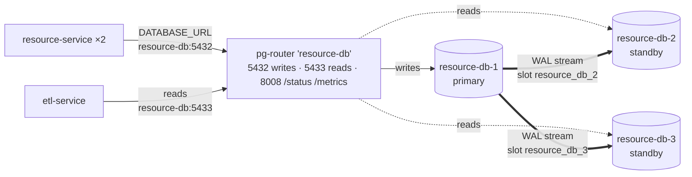

# Replicated PostgreSQL (Lab 5, Grade 5)

Every PostgreSQL database of a service runs as **one primary and two standbys** with streaming replication, behind a small router that always knows the primary and promotes a standby when the primary stops. The services do not change: the router has the old database's name, so `DATABASE_URL` stays the same.



| Piece | What it does | File |
|---|---|---|
| `<db>-1` | primary at the first start: `initdb`, then `init-replication.sh` creates the `replicator` user and the `pg_hba.conf` line; the seed runs here only, once | `init-replication.sh` |
| `<db>-2`, `<db>-3` | standbys: on an empty volume they clone the primary with `pg_basebackup -R -X stream -C -S <slot>` (`-R` writes `standby.signal` + `primary_conninfo`, `-C -S` creates the node's replication slot), then stream its WAL | `standby-entrypoint.sh` (all three nodes use it) |
| `pg-router` (`<db>`) | TCP router: **5432** → the current primary, **5433** → the standbys in turn (read only, for the ETL; the primary when no standby is up). Checks every node every 2 s (connect + `pg_is_in_recovery()`), fails over, fences, re-points | `pg-router/` → image `mituvladlen/pg-router:5.0.0` |

All nodes run `postgres:16-alpine` with `wal_level=replica`, `max_wal_senders=10`, `max_replication_slots=10`, `hot_standby=on`.

## Failover

1. The primary fails **`PG_FAILOVER_CHECKS` (3) checks in a row**, one every `PG_CHECK_INTERVAL_MS` (2000): unreachable, or answering but read-only.
2. The router picks the reachable standby with the **smallest lag** (highest `pg_last_wal_replay_lsn()`; on a tie, the first in `PG_NODES`) and runs `SELECT pg_promote(true, 60)` on it.
3. It creates a replication slot for every other standby on the new primary (slots are not replicated) and **re-points** them: `ALTER SYSTEM SET primary_conninfo = '...new primary...'`, `ALTER SYSTEM SET primary_slot_name`, `SELECT pg_reload_conf()`. A standby that was down at that moment is re-pointed as soon as it answers again.
4. It **closes every connection to the old primary**. New connections go to the new primary; connections opened during the failover wait up to `PG_CONNECT_WAIT_MS` (10 s) for it instead of failing. The services' pools log WARN `idle database connection closed` and reconnect on the next query.

Measured on the team compose: writes work again **6–9 s** after `docker stop <db>-1`, and the services answer again after **4.5–6 s** of errors (Resource gather and Base storage expand through the gateway, 2026-11-26).

**Fencing.** A node that is writable but is not the router's primary (the old primary started again with its old data) is **fenced**: `/status` shows `"role": "fenced"` and it never gets a connection, so it can never take writes next to the new primary. When the router itself restarts, the primary is the writable node on the **highest timeline** (a promotion starts a new one), so the stale old primary is fenced again.

**The router needs no superuser.** `init-replication.sh` grants the `replicator` user exactly what it uses: `pg_monitor` (lag, WAL receiver), `EXECUTE` on `pg_promote()` and `pg_reload_conf()`, `ALTER SYSTEM` on `primary_conninfo` and `primary_slot_name`. Function rights are per database, so they are granted in `postgres`, the database the router connects to.

**Known limitation.** The router is a **single point of failure**: if its container stops, the database is unreachable until Docker restarts it (`restart: unless-stopped`), even though all three nodes are fine. Production setups avoid it with a consensus store and several routers: **Patroni + etcd** (leader election, the clients use HAProxy or a virtual IP) or **pgpool-II** with its watchdog. For the lab, one router keeps the failover logic small and visible.

## Apply the template to a new database (5 steps)

Example: `game-db` of game-service (Alexandru), `player-db` / `crafting-db` (Gabriel).

1. **Compose: the nodes.** Replace the `<db>` block of `deploy/docker-compose.yml` with `<db>-1`, `<db>-2`, `<db>-3` built on `*pg-node`, copying `resource-db-1..3`: the same three volumes per node, `PG_NODE_NAME`, `PG_NODES: <db>-1:5432,<db>-2:5432,<db>-3:5432`, `PG_REPL_PASSWORD`, and `PG_INITIAL_PRIMARY: "true"` on `<db>-1` only. Keep your `POSTGRES_*` variables. If your database mounts init scripts (`../db-scripts/<service>:/docker-entrypoint-initdb.d`), mount them on **every** node next to `00-replication.sh`: they only run on the node that initialises the database, so the seed runs once, on `<db>-1`.
2. **Compose: the router.** Add a `<db>` service built on `*pg-router` with `ROUTER_NAME: <db>`, the same `PG_NODES` and `PG_REPL_PASSWORD`, and a free host port for 8008 (resource uses 8008, base 8009). Your service's `depends_on: <db>: condition: service_healthy` and its `DATABASE_URL` do not change: the router is healthy once it knows the primary.
3. **Volumes.** Replace `<db>-data` with `<db>-1-data`, `<db>-2-data`, `<db>-3-data` in the `volumes:` section.
4. **`.env.example`.** Add `<SERVICE>_PG_REPL_PASSWORD=change-me` (`setup-env.sh` fills every `change-me` with a random value).
5. **Check it.** `docker compose up -d`, then `curl localhost:<port>/status`: one `primary`, two `standby` with `lagBytes: 0`. Then run the failover demo below. Your service needs an `error` handler on its `pg.Pool` (Node) or a pool that drops broken connections (Go `database/sql` does), so a closed connection is not fatal.

## Demo

```bash
docker compose -f deploy/docker-compose.yml --env-file deploy/.env up -d
curl -s localhost:8008/status | jq '{primary, nodes: [.nodes[] | {name, role, state, lagBytes}]}'
# {"primary": "resource-db-1", nodes: [primary 0, standby 0, standby 0]}

docker stop deploy-resource-db-1-1        # the primary
docker logs -f deploy-resource-db-1       # "primary is down" ... "failover: promoting standby" ... "failover done" (~6 s)
curl -s localhost:8008/status | jq '.primary, .failovers'                     # "resource-db-2", 1
# Resource answers again: POST /resource/resources/gather through the gateway works
curl -s localhost:8008/metrics | grep -v '^#'                                  # pg_node_up, pg_replication_lag_bytes, pg_failovers_total
```

Reads go to a standby on 5433 and writes are refused there:

```bash
docker run --rm --network deploy_default -e PGPASSWORD=... postgres:16-alpine \
  psql -h resource-db -p 5433 -U resource_user -d resource_db -c 'SELECT pg_is_in_recovery()'   # t
```

## Bring the old primary back (as a standby)

Starting it again with its data only fences it (`/status`: `"role": "fenced"`), on purpose: its WAL may hold writes the new primary never got. To bring it back, **re-clone** it: delete its volume and start it again; `standby-entrypoint.sh` finds the current primary and runs `pg_basebackup` from it.

```bash
docker compose -f deploy/docker-compose.yml --env-file deploy/.env rm -sf resource-db-1
docker volume rm deploy_resource-db-1-data
docker compose -f deploy/docker-compose.yml --env-file deploy/.env up -d --no-deps resource-db-1
docker logs deploy-resource-db-1-1   # "cloning the primary resource-db-2:5432 (slot resource_db_1)", "clone done, starting as a standby"
curl -s localhost:8008/status | jq '[.nodes[] | {name, role, lagBytes}]'   # resource-db-1: standby, 0
```

It stays a standby: the router does not move the primary back (no second interruption). This step is manual on purpose, so nobody deletes a node's data by accident.

## pg-router reference

| Variable | Default | Meaning |
|---|---|---|
| `PG_NODES` | required | `host:port` of the nodes, comma separated; the first is the preferred one on a tie |
| `PG_REPL_PASSWORD` | required | password of the replication user (the router connects as it) |
| `PG_REPL_USER` | `replicator` | the replication user |
| `PG_FAILOVER_CHECKS` | `3` | failed checks of the primary in a row before a failover |
| `PG_CHECK_INTERVAL_MS` | `2000` | one round of checks every this many ms |
| `PG_CHECK_TIMEOUT_MS` | `1500` | a node answering slower than this failed the check |
| `PG_CONNECT_WAIT_MS` | `10000` | how long a new client connection waits for a primary during a failover |
| `ROUTER_NAME` | the hostname | name in the logs and metrics (`resource-db`) |
| `WRITE_PORT` / `READ_PORT` / `HTTP_PORT` | `5432` / `5433` / `8008` | |
| `LOG_LEVEL`, `LOG_DIR` | `info`, empty | JSON logs on stdout and in `$LOG_DIR/<router>.log` (the shared logs volume) |

`GET :8008/status`:

```json
{
  "router": "resource-db", "version": "5.0.0", "primary": "resource-db-2", "failovers": 1,
  "nodes": [
    {"name": "resource-db-1", "host": "resource-db-1", "port": 5432, "role": "fenced", "state": "up", "inRecovery": false,
     "lagBytes": null, "streamingFrom": null, "failedChecks": 0, "lastError": null, "lastCheckAt": "2026-11-26T22:57:31Z"},
    {"name": "resource-db-2", "role": "primary", "state": "up", "inRecovery": false, "lagBytes": 0, "...": "..."},
    {"name": "resource-db-3", "role": "standby", "state": "up", "inRecovery": true, "lagBytes": 0, "streamingFrom": "resource-db-2", "...": "..."}
  ],
  "connections": {"write": 10, "read": 0}
}
```

`role`: `primary`, `standby`, `fenced` or `unknown` (down / not checked yet). `GET :8008/health`: 200 when the router knows a primary, else 503 (the compose healthcheck).

`GET :8008/metrics` (Prometheus): `pg_node_up{router,node}`, `pg_node_is_primary{router,node}`, `pg_replication_lag_bytes{router,node}`, `pg_failovers_total{router}`, `pg_router_connections{router,port}`.

Logs: `primary found`, `node check failed`, `primary is down`, `failover: promoting standby`, `failover done`, `closed the connections to the old primary`, `standby re-pointed to the primary`, `node is writable but not the primary: fenced ...`, `fenced node came back as a standby`.

Tests: `cd deploy/postgres/pg-router && pip install -r requirements-dev.txt && pytest` (the decisions are unit tested with a fake backend; the failover itself was checked on the compose as above).
